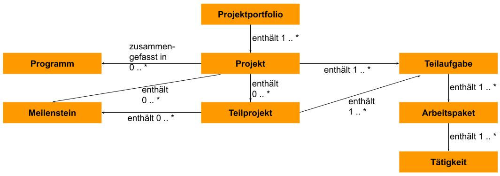
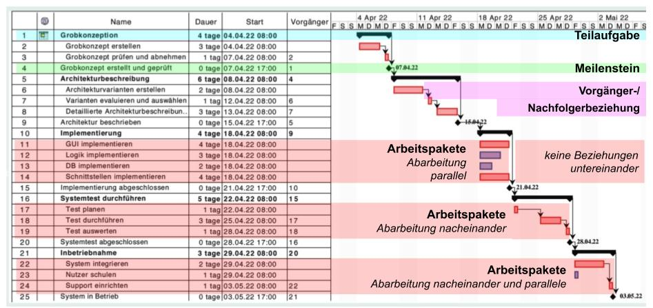
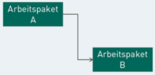
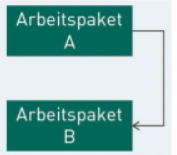
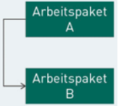
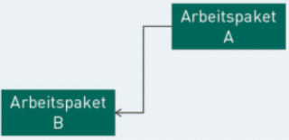
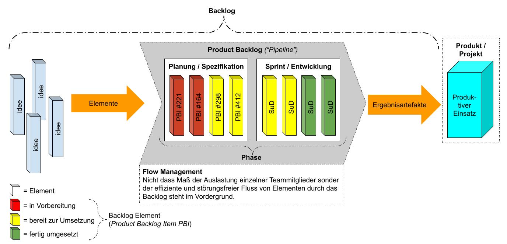
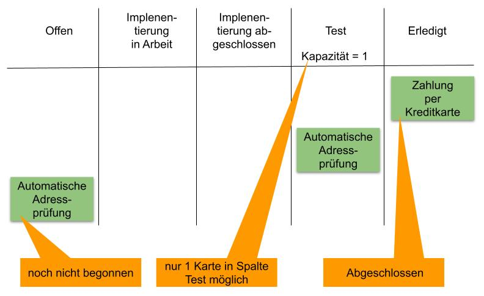

# IT-Projektmanagement

# L02 Planungstechniken

## Einleitung
*Bereits in den frühen Phasen eines IT-Projekts wird mit einer groben Zeitplanung begonnen, die im Verlauf des Projekts Schritt für Schritt verfeinert wird. Geplant werden dabei Projektphasen, Aktivitäten, Ereignisse und sogenannte Meilensteine. In dieser Lektion werden mit dem Gantt-Diagramm eine Planungstechnik für das Gesamtprojekt und mit dem Kanban Board Planungstechniken für einzelne Arbeitspakete vorgestellt und erläutert.*

LERNZIELE

<ul>
    <li>Wie mit den Konzepten Meilenstein, Teilaufgabe und Arbeitspaket ein Projekt strukturiert werden kann.</li>
    <li>Wie mit dem Gantt-Diagramm Projekte geplant werden und welche wichtigen Informationen mithilfe von Planungswerkzeugen automatisch bestimmt werden können.</li>
    <li>Wie ein Kanban Board bei der Planung und Organisation von Arbeitspaketen eingesetzt werden kann.</li>
</ul>

ZUSAMMENFASSUNG

Die Projektplanung im Großen lässt sich grob in zwei Hauptaktivitäten unterteilen:  
Identifikation und Beschreibung von Meilensteinen, Teilaufgaben und Arbeitspaketen sowie Bestimmen der Abhängigkeiten und der Abarbeitungsreihenfolge einzelner Arbeitspakete. Gantt-Diagramme werden in der Praxis sehr häufig für die Darstellung von Dauer und Abhängigkeiten von Meilensteinen, Teilaufgaben und Arbeitspaketen eingesetzt. Werden Projektpläne mithilfe von Projektmanagementprogrammen erstellt und sowohl die geplante Bearbeitungsdauer als auch bestehende Vorgänger-/Nachfolger-Beziehungen gespeichert, können automatisch Aussagen zu möglichen Start- und Endterminen sowie dem kritischen Pfad errechnet werden.  

Das Kanban Board ist eine Technik zur Planung und Visualisierung detaillierter Aktivitäten eines Arbeitspaketes. Dabei werden alle zu erledigenden Aufgaben in die linke Spalte des Boards geheftet. Im Verlauf der Abarbeitung wandern die Aufgaben von links nach rechts durch alle Spalten auf dem Board.  

Mit dem Begriff Backlog (deutsch: Arbeitsrückstand) wird eine geordnete Liste aller bekannten Dinge bezeichnet, die im Rahmen eines Vorhabens zu tun sind oder benötigt werden. Stark verallgemeinert ist es eine Todo-Liste, die ständig neu sortiert wird. Bei der Bearbeitung einer Aufgabe werden in der Regel weitere Erkenntnisse darüber gewonnen, was noch zu erledigen oder anzupassen ist. Diese Erkenntnisse werden dann ebenfalls in das Backlog aufgenommen.

---
## 2.1 Planung im Großen: Meilensteine, Teilaufgaben, Arbeitspakete

#### Die Planung hat zwei Kernziele:
1. Das Projekt gründlich durchdenken – dabei noch fehlende Aufgaben identifizieren.
2. Die Reihenfolge und Abhängigkeiten der Arbeitspakete festlegen.

#### Die Planung gliedert sich grob in zwei Hauptaktivitäten: 
1. die Grobplanung (*mit Meilensteinen*) und 
2. die Feinplanung (*mit Teilaufgaben und Arbeitspaketen*).

### Meilensteine
- Sind zeitliche Fixpunkte, die das Erreichen eines wichtigen Zwischenergebnisses markieren.
- Haben keine Dauer – sie sind ein definierter Moment, nicht ein Zeitraum.
- Werden in einem Meilensteinplan dargestellt (Symbol: ◆).
- Dienen der Koordination von Teilprojekten, Abhängigkeiten und der Grobplanung – besonders dann, wenn Details noch unklar sind.

*Beispiel für einen einfachen Meilensteinplan*
|◆ ID |Meilenstein |Datum |
|---|---|---|
|MS01 |Grobkonzept erstellt und geprüft |2022–03–01 |
|MS02 |Architektur beschrieben |2022–04–01 |
|MS03 |Implementierung abgeschlossen |2022–06–01 |
|MS04 |Systemtest abgeschlossen |2022–08–01 |
|MS05 |System in Betrieb |2022–09–01 |

### Teilaufgaben
- Sind größere, thematisch zusammenhängende Aufgabenblöcke, die sich noch weiter verfeinern lassen.
- Dienen der Strukturierung des Projekts auf einer mittleren Ebene.

### Arbeitspakete
- Fassen Tätigkeiten zusammen, die in sich abgeschlossen sind und ein überprüfbares Ergebnis liefern.
- Stellen die kleinste planbare Einheit dar.
- Ermöglichen paralleles Arbeiten mehrerer Personen im Projekt.

#### Wichtige Eigenschaften eines Arbeitspakets:
- **Ergebnis** (*Deliverables*):  
*Welche konkreten Ergebnisse werden durch die Bearbeitung des Arbeitspaketes erreicht?*
- **Start- und Enddatum**:  
*Wann kann/muss mit der Bearbeitung begonnen werden? Wann muss diese spätestens abgeschlossen sein?*
- **Dauer**:  
*Wie viele Kalendertage bzw. Personentage werden für die Bearbeitung veranschlagt bzw. stehen zur Verfügung?*
- **Verantwortlichkeiten**:  
*Welche Personen/Organisationseinheiten sind für die Bearbeitung und die Ergebnisse verantwortlich?*
- **Abhängigkeiten**:  
*zu anderen Arbeitspaketen bzw. Teilaufgaben und zu Meilensteinen*

#### Warum diese Struktur?
Nur durch die Aufteilung in Arbeitspakete können mehrere Personen sinnvoll zusammenarbeiten und die Projektleitung das Projekt effektiv steuern und überwachen.

*Zusammenhänge von Projektelementen als UML-Klassendiagramm*

---
## 2.2 Planung im Großen: GanttDiagramme
>Ein Gantt-Diagramm ist eine Art Balkendiagramm, das Dauer und Abhängigkeiten von Arbeitspaketen entlang einer Zeitachse darstellt. Es kombiniert eine Tabelle (*links: ID, Name, Dauer, Startdatum, Vorgänger*) mit einer grafischen Darstellung (*rechts*). Ist gut für die Gesamtplanung auf Überblicksebene, nicht für die Detailplanung einzelner kleiner Arbeitspakete.

|Element |Darstellung | Beschreibung |
|---|---|---|
|**Teilaufgaben** | |enthält Arbeitspakete, Dauer ergibt sich aus Dauer und Abhängigkeiten der enthaltenen Arbeitspakete (*nacheinander oder/und parallel*)|
|**Meilensteine** | |ohne Dauer (*0 Tage*), aber mit Termin |
|**Vorgänger-/Nachfolgerbeziehungen** | |Beziehung zwischen Vorgänger und Nachfolger |
|**Arbeitspakete** | |enthalten keine weiteren Elemente, Dauer > 0 (*Kritische Aktivitäten werden rot eingefärbt*) |

*Aktivität: alles was Zeitlich im Gantt dargestellt werden kann (Meilensteinen, Teilaufgaben, Arbeitspakete).* 

- **Pufferzeit**:  
Die Zeit, um die sich eine Aktivität verzögern darf, ohne dass das Gesamtprojekt in Verzug gerät.

- **Kritische Aktivität**:  
Eine Arbeitspakete, bei der die Pufferzeit gleich null ist. Jede Verzögerung hier = Verzögerung des gesamten Projekts.

- **Kritischer Pfad**:  
Die Abfolge aller kritischen Aktivitäten – also die längste Kette von Aufgaben ohne jeglichen Puffer, die vom Projektstart bis zum -ende reicht

### Die 4 Beziehungstypen zwischen Aktivitäten (*Arbeitspaketen*)
**Hinweis**: Aktivität = operative Begriff für Arbeitsp. im Zeitlichen Ablauf (*Gantt*), Arbeitspaket = Planungsbegriff aus dem Projektstrukturplan. Beide beschreiben das selbe Konzept nur aus leicht unterschiedlichen Perspektiven. 
|Typ |Darstellung |Beschreibung |Beispiel |
|---|---|---|---|
|**Ende zu Anfang** | |**B** startet erst, wenn **A** fertig ist (*häufigster Typ*) |*Mit Aktivitäten zur Qualitätssicherung kann erst begonnen werden, wenn etwas Prüfbares erzeugt wurde.* |
|**Ende zu Ende** | |**B** endet erst, wenn **A** endet |*Die Implementierung der GUI kann erst abgeschlossen werden, wenn die Implementierung der Logik abgeschlossen wurde.* |
|**Anfang zu Anfang** | |**B** startet, sobald **A** beginnt |*Das System kann erst dann von den Anwendenden genutzt werden, wenn das Supportteam mit der Arbeit begonnen hat.* |
|**Anfang zu Ende** | |**B** darf erst enden, wenn **A** begonnen hat (*selten*) |*Der Betrieb des Altsystems kann erst beendet werden, wenn der Betrieb des neuen Systems begonnen hat.* |

### Automatisch berechnete Risikoinformationen
Moderne Projektmanagementprogrammen (*z.B. MS Project, Project Libre*) berechnen auf Basis der Abhängigkeiten (*Bearbeitungsdauer und Vorgänger-/Nachfolgerbeziehungen*) automatisch:

- **Start- und Endterminen**
- **Pufferzeit**: *Zeit, um die sich ein Arbeitspaket verzögern darf, ohne das Gesamtprojekt zu beeinflussen*
- **Kritische Aktivitäten**: *Arbeitspakete ohne Pufferzeit (rot markiert)*
- **Kritischer Pfad**: *die Abfolge kritischer Aktivitäten, die die Mindestdauer des Projekts bestimmt*

### Typische Einsatzszenarien
- Kommunikation im Team und gegenüber Auftraggebenden
- Ressourcenplanung
- Risikoanalyse
- Analyse von Abhängigkeiten und Verzögerungen

---
## 2.3 Operative Planung und Organisation: Kanban Board, Backlog
>Während das Gantt-Diagramm den Gesamtüberblick über ein Projekt liefert, eignen sich Kanban Board und Backlog für die Detailplanung innerhalb von Arbeitspaketen.

### Backlog (*Arbeitsrückstand*)
>Ein Backlog ist eine geordnete, priorisierte Liste aller bekannten Aufgaben, die in einem Vorhaben erledigt werden müssen (*eine dynamische To-do-Liste*), die ständig neu sortiert wird. Bei der Bearbeitung einer Aufgabe werden in der Regel weitere Erkenntnisse darüber gewonnen, was noch zu erledigen oder anzupassen ist. Diese Erkenntnisse werden dann ebenfalls in das Backlog aufgenommen. 

*Product Backlog als Pipeline*

#### Grundprinzip – Pipeline:
Das Backlog kann als eine Pipeline verstanden werden. Die darin transportierten Backlog-Elemente beinhalten erlangtes Wissen und Erkenntnisse, die das Entwicklungsteam zur Erstellung von Ergebnisartefakten braucht. Sobald erkannt wird, dass etwas für das Produkt oder das Projekt erforderlich ist, wird es als Element in das Backlog aufgenommen. Die Elemente werden über verschiedene Phasen durch den Prozess transportiert. Ist ein Element fertig umgesetzt, kann es aus der Pipeline herausfließen und einen Mehrwert für die Kunden bieten.

#### Zwei Phasen eines Backlog-Elements:
1. **Planung/Spezifikation**:   
*Die aktuell wichtigsten Backlog Elemente werden ausgewählt um anschließend alle Informationen zu erarbeitet, die das Entwicklungsteam braucht, um sie zu realisieren. In regelmäßigen Abständen werden die Backlog-Elemente bestimmt, die für die nächste System- bzw. Produktversion umgesetzt werden sollen.*
2. **Entwicklung/Sprint**:  
*Element werden umgesetzt; die Menge wird während dieser Phase nicht verändert.*

#### Wichtige Eigenschaften:
- Das Backlog ist **emergent**, es verändert sich kontinuierlich (*neue Elemente werden angelegt bzw. umgesetzt*)
- Nicht alles im Backlog muss umgesetzt werden
- Regelmäßige **Priorisierung** ist entscheidend
- **Planungsebenen** eines Backlogs wird je nach Betrachtung skaliert (*von Programm- bis zur Arbeitspaket-Ebene*) 

#### Bekannte Varianten (*aus Scrum*):
- **Product Backlog**: *eine kontinuierlich angepasste Liste aller Dinge, die zur Verbesserung eines Produktes erforderlich sind (z.B. Anforderungen, Bugs).*
- **Sprint Backlog**: *eine unveränderliche Teilmenge der Elemente aus dem Produkt Backlog, die bei der Lieferung einer Produktversion berücksichtigt werden.*

Tools: Trello, Asana, Microsoft To Do, Jira

### Kanban Board (*japanisch "Karte"*)
>Das Kanban Board kann optimal mit dem Backlog kombiniert werden, insbesondere zur Steuerung der Backlog Elemente in der Phase Entwicklung.

#### Grundprinzip
Alle Aufgaben eines bestimmten Zeitraums werden auf Karten notiert und in die linke Spalte des Kanban Boards geheftet. Der Zeitraum kann etwa eine Woche, eine Projektphase oder im Rahmen der evolutionären Softwareentwicklung ein Zyklus sein. Die Spalten beschreiben die einzelnen Schritte in der Entwicklung. 

- **Karten Informationen**:  
    - Karten können um zusätzliche Informationen erweitert werden (*z.B. Bearbeiter, geschätztem Aufwand, Priorität,...*). 
- **Kapazitätsgrenze**:  
    - Legt fest wie viele Aufgaben (*Karten*) eine Stufe (*Spalte*) haben darf.
    - Hilft bei der Identifizierung von Engpässen.
    - Teammitglieder können sich auf eine Aufgabe fokussieren.
- **Transparenz**:
    - Die aktuelle Projektsituation (*Ist-Zustand*) ist sofort ersichtlich.
    - Kommunikationsunterstützung (*z.B. Management, Stakeholdern,...*)
- **Aufgaben eigenverantwortlich wählen**:  
    - Mikromanagement der Teamleitung wird verhindert und dem Team wird die Möglichkeit einer verantwortungsvollen Selbstorganisation eingeräumt.