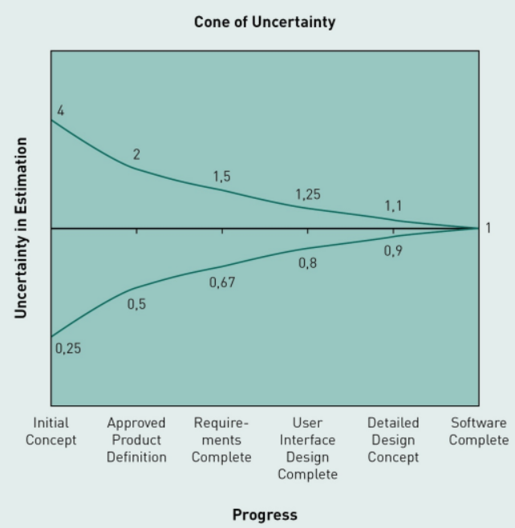
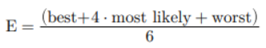
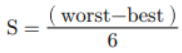
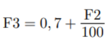
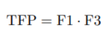
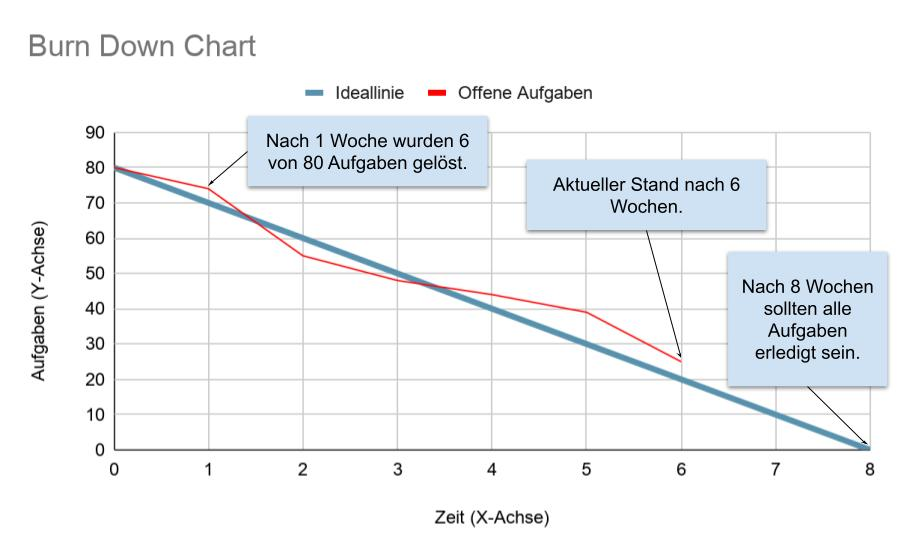
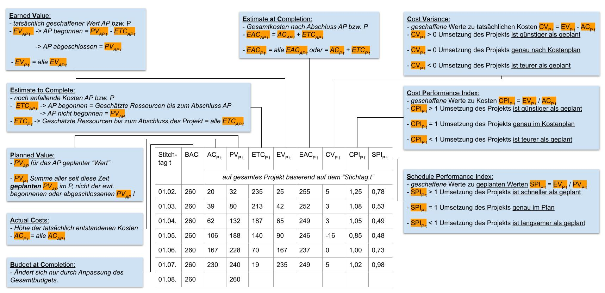
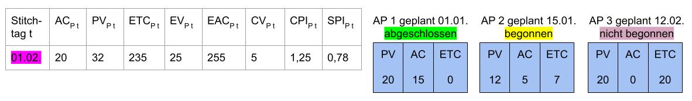

# IT-Projektmanagement

# L03 Priorisierung, Aufwandsschätzung, Projektcontrolling

## Einleitung
*In dieser Lektion werden konkrete Techniken zum Einsatz bei Aktivitäten im IT-Projektmanagement vermittelt. Jede dieser Techniken kann dabei in jedem Vorgehensmodell eingesetzt werden, egal ob eher planbasiert oder iterativ gesteuert wird. Zunächst werden die Priorisierungstechniken MoSCoW-Methode und Ranking erläutert. Im Anschluss werden mit der zweifachen Expertenschätzung die Organisation von Aufwandsschätzungen vorgestellt und mit der Drei-Punkt-Schätzung sowie dem Function-Point-Verfahren konkrete Schätztechniken beschrieben. Zuletzt werden mit dem Burn Down Chart und der EarnedValue-Analyse zwei unterschiedliche Methoden für die projektbegleitende Kostenkontrolle eingeführt.*

LERNZIELE

<ul>
    <li>Wie Aufgaben mit der MoSCoW-Methode und dem Team Estimation Game einfach priorisiert werden können.</li>
    <li>Wie Schätzprozesse organisiert werden und wie mit der Drei-Punkt-Schätzung und dem Function-Point-Verfahren Aufwände geschätzt werden können.</li>
    <li>Wie das Projektcontrolling mit Burn Down Charts und der Earned-Value-Analyse durchgeführt werden kann.</li>
</ul>

ZUSAMMENFASSUNG

Die MoSCoW-Methode ist eine Priorisierungstechnik, mit der Aufgaben in eine von vier verschiedenen Dringlichkeitskategorien einsortiert werden. Damit lassen sich Aufgaben grob clustern. Mit der Technik Team Estimation Game lassen sich Anforderungen nach ihrer Priorität in eine lineare totale Ordnung, d. h. eine echte Reihenfolge bringen. Damit wird die Menge der Anforderungen vollständig sortierbar und kann der Reihe nach abgearbeitet werden.  

Bei der zweifachen Expertenschätzung wird der Aufwand zur Erstellung bzw. Bearbeitung eines Arbeitspakets auf Basis der aktuell verfügbaren Informationen unabhängig voneinander von zwei Expert bzw. Expertenteams geschätzt und deren Ergebnisse anschließend konsolidiert. Die Drei-Punkt-Schätzung ist eine pragmatische Schätzmethode, die auf Basis des geschätzten minimalen Aufwands, des geschätzten maximalen Aufwands und dem geschätzten wahrscheinlichen Aufwand einen Erwartungswert ermittelt, der für die Projektplanung angenommen werden kann. Das Function-Point-Verfahren ermittelt den Schätzwert auf Basis einer detaillierten Spezifikation sowie projektspezifischen Einflussfaktoren.

Das Burn Down Chart eignet sich zur Darstellung aller Größen eines Arbeitspakets, die in einer bestimmten Zeitspanne verbraucht oder abgearbeitet werden sollen. Es unterstützt damit insbesondere die Kommunikation und Steuerung von einzelnen Arbeitspaketen. Die EarnedValue-Analyse ist ein Kennzahlensystem, das sich für die kontinuierliche Erfassung und Bewertung der Kosten von IT-Projekten eignet. Neben den tatsächlich verbrauchten Aufwänden ist ein wichtiges Element der Earned-Value-Analyse die Einbeziehung kontinuierlich geschätzter Restaufwände.

---
## 3.1 Priorisierung
Das priorisieren von Aufgaben (*Anforderungen, Aktivitäten, Arbeitspakete, Fehler, ...*) ist eine projektbegleitende Daueraufgabe:
- am Anfang, 
- während (*aufgrund ändernder fachlicher Anforderungen, technisch oder organisatorischer Rahmenbedingungen*),
- in den letzten Projektphasen (*unter Berücksichtigung der noch zur Verfügung stehenden Ressourcen*)

### MoSCoW-Methode
Aufgaben werden in vier Kategorien eingeteilt:

|Kategorie |Bedeutung |
|---|---|
|**Must have**  *Muss*|Essenziell, nicht verhandelbar.  Müssen für einen erfolgreichen Projektabschluss umgesetzt werden.|
|**Should have**   *Soll*|Wichtig, aber nicht kritisch.  Spielen für den Erfolg des Projekts eine sehr große Rolle.|
|**Could have**	  *Kann*|Optional – nur wenn alles andere erledigt ist.|
|**Won't have**	  *Nicht umsetzen*|Aktuell nicht umgesetzt (*evtl. später*).|

**Praxisproblem:** Stakeholder neigen dazu, fast alles als „Must" oder „Should" einzustufen – dann braucht man eine weitere Feinpriorisierung.

### Ranking
Ziel: Eine lineare Reihenfolge aller Aufgaben, sodass klar ist, was als Nächstes kommt.

1. Jede Aufgabe auf eine Karte schreiben → verdeckter Stapel
2. Erste Karte aufdecken und auf den Tisch legen
3. Reihum: Neue Karte einordnen oder vorhandene Karte verschieben
4. Spiel endet, wenn niemand mehr tauschen möchte

**Tipp:** MoSCoW + Ranking kombinieren – erst grob clustern, dann innerhalb der wichtigsten Kategorie fein priorisieren.

---
## 3.2 Aufwandsschätzung
Aufwandsschätzungen sind unvermeidlich – auch wenn sie ungenau sind. Ohne sie können weder Budgets geplant noch Projektentscheidungen getroffen werden.

### Der Cone of Uncertainty (*wirtschaftliche Ungewissheit*)
>**Je früher eine Schätzung gemacht wird, desto größer ist die mögliche Abweichung vom tatsächlichen Aufwand.**

Erst am Projektende ist der echte Aufwand bekannt. Im Gegensatz zu klassischen Produktionsprozessen lässt sich Softwareentwicklung kaum präzise vorausberechnen (*"Erkenntnis getriebener Prozess"*).

### Zweifache Expertenschätzung
1. Festlegen von zwei Experten(teams)
2. Bereitstellung aller verfügbaren Informationen, auf Basis derer die Schätzung erfolgen soll
3. Parallele Schätzung des Aufwands durch die beiden Expertenteams (*kein Austausch!*)
4. Vorstellung und Konsolidierung der Schätzergebnisse in einem Workshop, fortlaufende Diskussion, bis Einigung erzielt wird.

- Besonders sinnvoll in frühen Projektphasen
- Stark abweichende Ergebnisse = hohes Projektrisiken (*Risikoliste*) oder ungenaue Anforderungen

### Drei-Punkt-Schätzung (PERT)

**INFO**: PERT (_**P**rogram **E**valuation and **R**eview **T**echnique_)

Die Methode wurde in den 1950er-Jahren vom US-amerikanischen Militär entwickelt, um Aufwände für die Entwicklung unbekannter technischer Komponenten zu schätzen. Daher eignet sie sich besonders gut für Situationen mit hoher Unsicherheit – wie es bei Softwareprojekten häufig der Fall ist.

Bezieht sich zur Ermittlung des Schätzwertes auf folgende drei Zahlen:
- geschätzter **Best-Case-Aufwand** (`best`):  
*ein nach bestem Wissen und Gewissen geschätzter minimaler Aufwand, für den Fall, dass alles gut geht;*
- geschätzter **Worst-Case-Aufwand** (`worst`):  
*ein nach bestem Wissen und Gewissen geschätzter maximaler Aufwand, für den Fall, dass alles schiefläuft, was schieflaufen
kann;*
- geschätzter **wahrscheinlichster Aufwand** (`most likely`):  
*ein nach bestem Wissen und Gewissen geschätzter Aufwand, der als der wahrscheinlichste angenommen wird, bzw. von dem die schätzende Person glaubt, dass bei mehrfacher Umsetzung dieser Wert am häufigsten getroffen wird.*

#### Formeln:
- Der **Erwartungswert** `E` :  

- Die **Standardabweichung** `S` (*wie genau der Erwartungswert ist*) :    

- Beispiel:  
Das Team schätzt die Umsetzung der Funktion „Automatische Adressvalidierung“ mit:  
`best` = 4 Tage, `worst` = 16 Tage und `most likely` = 9 Tage, daraus ergibt sich:  
`E` = 9,3 Tage, `S` = 2 Tage.

### Function-Point-Verfahren
**Hinweis:**
In der Literatur finden sich verschiedene Einflussfaktoren, Berechnungsformeln und Korrelationstabellen. Das hier vorgestellte Verfahren dient daher nur als exemplarische Veranschaulichung der Funktionsweise von Function-Point-Verfahren.

#### grundsätzliche Verfahren von Schätzungen mit Function Points:
1. Analysieren, Kategorisieren, Zählen und Bewerten von geforderten Funktionen und Daten, dann Einschätzen der Komplexität und Ermitteln eines ersten Function-Point Wertes.
2. Analysieren und Bewerten von projektspezifischen Einflussfaktoren (*z.B. Qualitätseigenschaften und Ermittlung eines Anpassungsfaktors*).
3. Ermitteln des Schätzergebnisses durch Berücksichtigung der ermittelten Systemkomplexität und des Anpassungsfaktors.

In der Praxis werden häufig organisationsspezifische Faktoren, Formeln und Werte eingesetzt, auf deren Basis dann gezielt Schätzungen auf das Kostenmodell der eigenen IT Organisation abgestimmt werden. Dabei werden neben dem eigentlichen Entwicklungsaufwand auch Aufwände für Tests, Inbetriebnahme und Projektmanagement einbezogen.  
Eine wichtige Voraussetzung für den Einsatz von Function-Point-Verfahren ist in jedem Fall das Vorliegen einer detaillierten technischen Spezifikation sowie deren detaillierte Analyse.

1. Schritt: Analyse des zu schätzenden Systems hinsichtlich dessen Funktionen (*nach Wieczorrek*)

Das zu schätzende System (*bzw. Arbeitspaket*) wird in einzelne Komponenten aufgeteilt, die auf die Art und Anzahl der zu implementierenden Funktionen untersucht werden. 

|Art/Kategorie |Beschreibung |Beispiel |
|---|---|---|
|Eingabedaten,  **E**xternal **I**nput (**EI**)  (Typ: Transaktionselement) |Dateneingaben in das System/die Komponente, die ein Nutzer oder ein System per technischer Schnittstelle vornimmt. Eingaben für das Erstellen, Bearbeiten und Löschen werden jeweils extra gezählt, da für jede dieser Operationen eine eigene Transaktion benötigt wird. |- Kundendaten aus Kundensystem einlesen. |
|Ausgabedaten,  **E**xternal **O**utput (**EO**)  (Typ: Transaktionselement) |Datenausgaben, die wie die Eingabedaten sowohl Nutzer- als auch Systemschnittstellen umfassen. |- Geänderte Kundendaten in Kundensystem speichern. - Kunden im Kundensystem löschen. |
|Abfragen,  **E**xternal **Q**uery (**EQ**)  (Typ: Transaktionselement) |Umfasst alle durch die Nutzenden angestoßenen (Such-)Anfragen an Datenbestände, ohne die Daten zu verändern. |- Alle Bestellungen zu bestimmten Kunden ermitteln. |
|Datenbestände,   **I**nternal **L**ogical **F**ile (**ILF**)  (Typ: Datenelement) |Interne Datenbanken und Dateien, die das betrachtete System/die Komponente erstellt, bearbeitet und speichert, jedoch keine temporären, zur Verarbeitung benötigten Datenspeicher. |- Historie aller Kundenkontakte|
|Referenzdaten,   **E**xternal **I**nterface **F**ile (**EIF**)   (Typ: Datenelement) |Datenbestände, die vom betrachteten System/der Komponente nur gelesen, jedoch nicht erstellt, bearbeitet oder gelöscht werden. |- Bestelldatenbank|

2. Schritt: Bewerten der Funktionskategorien aus Schritt 1 (*nach Wieczorrek*)

Im zweiten Schritt werden die in Schritt 1 identifizierten Funktionen und Datenbestände den Komplexitätsstufen einfach, mittel und komplex zugeordnet. Dazu wird jeweils die Umsetzungskomplexität eingeschätzt und die entsprechende Komplexitätsstufe vermerkt.

|Funktionskategorie |einfach |mittel |komplex |Beispiel: Function Points FP |
|---|---|---|---|---|
|Eingabedaten| 3| 4| 6 |- Kundendaten aus Kundensystem einlesen   = (leicht) `FP: 3`. |
|Ausgabedaten| 4| 5| 7 |-  Geänderte Kundendaten in Kundensystem speichern    = (komplex) `FP: 7`. - Kunden im Kundensystem löschen    = (mittel) `FP: 5`. |
|Abfragen |3 |4 |6 |- Alle Bestellungen zu bestimmten Kund:innen ermitteln    = (mittel) `FP: 4`. |
|Datenbestände |7 |10 |15 |- Historie aller Kundenkontakte    = (komplex) `FP: 15`. |
|Referenzdaten |5 |7 |10 |- Bestelldatenbank    = (mittel) `FP: 7`. |
|||||**Summe**: `F1 = 41` |

3. Schritt: Analyse von projektspezifischen Einflussfaktoren (*nach Wieczorrek*)

Die Einflussfaktoren werden hinsichtlich des zu schätzenden Systems bewertet und auf einer sechsstufigen Skala (*nach Wieczorrek*) wie folgt bewertet:

|Kein Einfluss |Gelegentlicher Einfluss |Mäßiger Einfluss |Mittlerer Einfluss |Bedeutender Einfluss |Starker Einfluss |
|---|---|---|---|---|---|
|0 |1 |2 |3 |4 |5 |

|Projektspezifische Einflussfaktoren *nach Wieczorrek* |Beispiel: Bewertung |
|---|---|
|algorithmische Komplexität der durchzuführenden Rechenoperationen (*wird doppelt gewertet*) | --- |
|Zahl der zu berücksichtigenden Ausnahmen im Programmablauf (*wird doppelt gewertet*) |1 ⋅ 2 = `2` |
|Abhängigkeiten zu anderen IT-Systemen |`5` |
|verteilte Verarbeitung und verteilte Datenhaltung |`4` |
|Grad der Anforderungen an IT-Sicherheit |`4` |
|Anforderungen an die Performance |`3` |
|Konvertierungen von Datenbeständen erforderlich |`1` |
|Anforderungen an Wartbarkeit und Usability |`3` |
|Grad der Komplexität der zu implementierenden Geschäftslogik |`1` |
|Anforderungen an Wiederverwendbarkeit einzelner Komponenten |`2` |
| |**Summe**: `F2 = 33` |

- Nach der Bewertung der Einflussfaktoren und deren Summierung zu einem Wert F2 wird ein Wert F3 nach folgender Vorschrift ermittelt:  

- Beispiel:  
**Summe**: `F3 = 0,7 + 33/100 = 1,03`

4. Schritt: Ermittlung der Total Function Points (nach Wieczorrek)

Im vierten Schritt wird die Kennzahl Total Function Points (TFP) mit der folgenden Berechnungsvorschrift ermittelt:  

- Beispiel:  
**Summe**: `TFP = 41 * 1,03 = 42,23`

5. Schritt: Ableitung des Entwicklungsaufwands (nach Wieczorrek)

Nach der Bestimmung der Kenngröße TFP wird die Ableitung zum geschätzten Entwicklungsaufwand durchgeführt. Hierzu dienen Korrelationstabellen. Der geschätzte Aufwand steigt hierbei im Verhältnis schneller als die TFP, da Koordinations- und Kommunikationsaufwände in größeren Gruppen nichtlinear steigen.

*Beispiel einer Tabelle (nach Wieczorrek) zur Ableitung von Entwicklungsaufwänden:*
|TFP  (*Total* *Function* *Points*)|PM   (*Personen-* *monate*)|TFP  (*Total* *Function* *Points*)|PM   (*Personen-* *monate*) |TFP  (*Total* *Function* *Points*)|PM   (*Personen-* *monate*) |
|---|---|---|---|---|---|
|150 |5 |500 |33 |850 |61 |
|200 |9 |550 |37 |900 |65 |
|250 |13 |600 |41 |950 |70 |
|300 |17 |650 |45 |1000 |75 |
|350 |21 |700 |49 |1050 |84 |
|400 |25 |750 |53 |1100 |93 |
|450 |29 |800 |57 |... |... |

- Beispiel:  
Der Entwicklungsaufwand liegt `unter fünf Personenmonate`. Damit handelt es sich um ein relativ kleines IT-Projekt.

---
## 3.3 Projektcontrolling
Ziel ist es, den Projektfortschritt messbar und transparent zu machen – nicht nur nach Bauchgefühl (*„ist zu 60 % fertig"*).
### Burn Down Chart
Eine Visualisierung, die zeigt, wie viele offene Aufgaben noch verbleiben.

- **X-Achse**:  
Zeit (*z.B. Wochen, Arbeitspakete, Sprints, Projekt*)
- **Y-Achse**:  
stellt die Einheit bzw. Kennzahl dar, deren Verlauf über die Zeit veranschaulicht werden soll (*z.B. offene Aufgaben, verbrauchten Ressourcen*).
- **Ideallinie**:  
verläuft linear von links oben (*alle Aufgaben*) nach rechts unten (*ende der Zeit*), dabei werden die Aufgaben "verbrannt". 
- **Tatsächliche Kurve**:  
zeigt den echten Fortschritt

### Earned-Value-Analyse (*Ertragswertanalyse*)

|Name |Abkürzung |Beschreibung |
|---|---|---|
|**Budget at Completion** (*Budget bei Projektende*) |**BAC** |- Geplantes bzw. geschätztes Gesamtbudget des Projekts. Diese Zahl ändert sich über die Projektlaufzeit nur durch Anpassungen des Gesamtbudgets, beispielsweise nach Change Requests der Auftraggebenden. - Die Einheit von `BAC` ist beispielsweise Geld in EUR oder Zeit in Personentagen. |
|**Planned Value** (*geplanter Wert*) |**PVAP** |- Geplante Aufwände für das gesamte Arbeitspaket `AP`. - Dieser Wert ergibt sich durch die im Projektplan eingeplanten Ressourcen wie Personal- oder Hardwarekosten, die für das Arbeitspaket eingeplant werden.  - Ist ein Arbeitspaket beendet, so wurden im Projekt, Werte im Umfang der für ein Arbeitspaket ursprünglich geplanten Kosten geschaffen.|
||**PVP t** |- Geplante Aufwände für ein Projekt `P` zum Zeitpunkt `t`.  - Ergibt sich aus der Summe aller bis zum Zeitpunkt `t` ~erarbeiteten~ **geplanten** (*NICHT erarbeiteten Werten!!!*) Werte `PV``AP t` in einem Projekt `P`.|
|**Actual Costs** (*tatsächliche Kosten*) |**ACAP t** |- Höhe der tatsächlich bisher entstandenen Kosten in einem Arbeitspaket `AP` zum Zeitpunkt `t`. |
||**ACP t** |- Höhe der tatsächlich entstandenen Kosten im Projekt `P` zum Zeitpunkt `t`. - Ergibt sich aus der Summe aller `AC``AP t` in einem Projekt `P`. |
|**Estimate to Complete**  (*geschätzte Kosten zum Abschluss*) |**ETCAP t** |- Am Zeitpunkt `t` geschätzte noch anfallende Kosten zur Fertigstellung des Arbeitspakets `AP`. - Wurde das Arbeitspaket `AP` bereits begonnen, d.h. ist `AC``AP t` > 0, wird `ETC``AP t` zum Zeitpunkt `t` neu geschätzt. - Wurde das Arbeitspaket `AP` noch nicht begonnen, gilt `ETC``AP t` = `PV``AP`. |
||**ETCP t** |- Am Zeitpunkt `t` alle geschätzten noch anfallenden Kosten, um das Projekt `P` fertigzustellen. - Ergibt sich aus der Summe aller `ETC``AP t` in einem Projekt `P`. |
|**Earned Value**  (*geschaffene Werte*) |**EVAP t** |- Tatsächlich geschaffener Wert in einem Arbeitspaket `AP` zum Zeitpunkt `t`. - Der geschaffene Wert entspricht den tatsächlich abrechenbaren Leistungen.  - Handelt es sich um Arbeitspakete, deren Aufwände sich fast vollständig aus Personalaufwänden ergeben, kann der `EV` als Differenz von geplanten Werten (`PV`) und den zum Abschluss noch benötigten Aufwänden (`ETC`) errechnet werden.  Falls `AC``AP t` = 0, dann `EV``AP t` = 0,  sonst: `EV``AP t` = `PV``AP t` - `ETC``AP t`.  Anderenfalls muss der EV geschätzt werden |
||**EVP t** |- Tatsächlich geschaffene Werte in einem Projekt `P` zum Zeitpunkt `t`.  - Ergibt sich aus der Summe aller `EV``AP t` zum Zeitpunkt `t` |
|**Estimate at Completion**  (*geschätzte Aufwände bei Abschluss*) |**EACAP t** |- Einschätzung zum Zeitpunkt `t`, wie hoch die Gesamtkosten eines Arbeitspakets `AP` nach dessen Abschluss sein werden.  - Kennzahl `EAC` ergibt sich aus der Summe der tatsächlichen Aufwände (`AC`) und den geschätzten noch zu leistenden Aufwänden (`ETC`)  `EAC``AP t` = `AC``AP t` + `ETC``AP t`. |
||**EACP t** |- Einschätzung zum Zeitpunkt `t`, wie hoch die Gesamtkosten eines Projekts `P` nach dessen Abschluss sein werden.  - Ergibt sich aus der Summe aller `EAC``AP t` oder `EAC``P t` = `AC``P t` + `ETC``P t`. |
|**Schedule Variance**  (*Planabweichung*) |**SVP t** |- Planabweichung eines Projekts `P` zum Zeitpunkt `t`.  `SV``P t` = `EV``P t` - `PV``P t`  - Wenn `SV``P t` > 0, dann ist die Abarbeitung eines Projekts `P` zum Zeitpunkt `t` schneller als geplant.  - Wenn `SV``P t` = 0, dann ist die Abarbeitung eines Projekts `P` zum Zeitpunkt `t` genau im Zeitplan.  - Wenn `SV``P t` < 0, dann ist die Abarbeitung eines Projekts `P` zum Zeitpunkt `t` langsamer als geplant. |
|**Cost Variance** (*Kostenabweichung*) |**CVP t** |- Abweichung der erarbeiteten Werte zu den tatsächlichen Kosten eines Projekts `P` zum Zeitpunkt `t`.   `CV``P t` = `EV``P t` - `AC``P t`  - Wenn `CV``AP t` > 0, dann ist die Abarbeitung eines Projekts `P` zum Zeitpunkt `t` günstiger als geplant.  - Wenn `CV``AP t` = 0, dann ist die Abarbeitung eines Projekts `P` zum Zeitpunkt `t` genau im Kostenplan.  - Wenn `CV``AP t` < 0, dann ist die Abarbeitung eines Projektes `P` zum Zeitpunkt `t` teurer als geplant. |
|**Schedule Performance Index**  (*Zeiteffizienzindikator*) |**SPIP t** |- Das Verhältnis der Planabweichung zur initialen Projektplanung eines Projekts `P` zum Zeitpunkt `t`.   `SPI``P t` = `EV``P t` / `PV``P t` (*Nur geplante PV nicht erarbeitete Werte!*)  - Wenn `SPI``P t` > 1, dann ist die Abarbeitung eines Projekts `P` zum Zeitpunkt `t` schneller als geplant.  - Wenn `PI``P t` = 1, dann ist die Abarbeitung eines Projekts `P` zum Zeitpunkt `t` genau im Plan.  - Wenn `SPI``P t` < 1, dann ist die Abarbeitung eines Projekts `P` zum Zeitpunkt `t` langsamer als geplant. |
|**Cost Performance Index**  (*Kosteneffizienzindikator*) |**CPIP t** |- Das Verhältnis der tatsächlich geschaffenen Werte bzw. Leistungen zu den tatsächlich entstandenen Kosten in einem Projekt `P` zum Zeitpunkt `t`.  `CPI``P t` = `EV``P t` / `AC``P t`  - Wenn `CPI``P t` > 1, dann ist die Abarbeitung eines Projekts `P` zum Zeitpunkt `t` günstiger als geplant.  - Wenn `CPI``P t` = 1, dann ist die Abarbeitung eines Projekts `P` zum Zeitpunkt `t` genau im Kostenplan.  - Wenn `CPI``P t` < 1, dann ist die eines Projekts `P` zum Zeitpunkt `t` teurer als geplant. |

Ein Wert wird für ein Arbeitspaket wird mit dem "**Planned Value**" geschätzt. Dieser Wert kann sich aus den Hardware und Personalkosten (*z.B.Personen Tage oder Monate*) zusammensetzen. Ist das Arbeitspaket abgeschlossen, dann wurde dieser Wert "geschaffen" und als "**Earned Value**" ausgedrückt. Die eigentlichen Kosten um diesen Wert zu erzeugen ist der "**Actual Coast**", welcher niedriger (*CPIP t > 1*) oder höher (*CPIP t < 1*) als geplant (*PV*) sein kann.  
Wichtig zu beachten ist wann die Daten gemessen wurden (*Stichtag*) und für wann das Arbeitspaket geplant ist!
Der "**Scheduled Performance Index**" drückt aus wie Gut das Projekt in der Zeit liegt (*z.B. SPIP t > 1 schneller als geplant*).

- **ACP t** : `20` = *alle* ACabgeschlossene AP + *alle* ACbegonnene AP = 15 + 5
- **PVP t** : `32` = *alle* PVgeplant vor Stichtag t AP = 20 + 12 (*nur AP **geplant** vor Stichtag!*)
- **ETCP t** : `235` = *alle* PVnicht begonnene AP + *alle* ETCbegonnene AP = 228 + 7  
(*_alle_ PVnicht begonnene AP = BAC - *alle* PVabgeschlossene AP - *alle* PVbegonnene AP  
= 260 - 20 - 12 für dieses Beispiel angenommen*)
- **EVP t** : `25` = *alle* PVabgeschlossene AP + *alle* PVbegonnene AP - *alle* ETCbegonnene AP = 20 + 12 - 7
- **EACP t** : `255` = ACP t + ETCP t = 20 + 235
- **CVP t** : `5` = EVP t - ACP t = 25 - 20
- **CPIP t** : `1.25` = EVP t / ACP t = 25 / 20
- **SPIP t** : `0.78` = EVP t / PVP t = 25 / 32