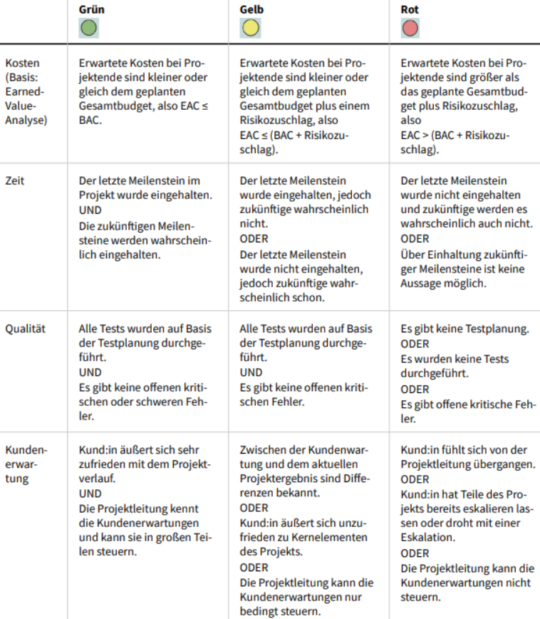
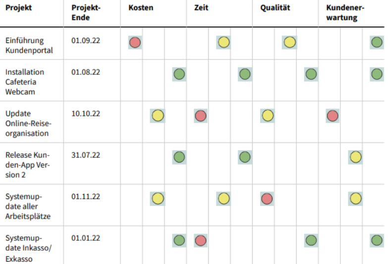
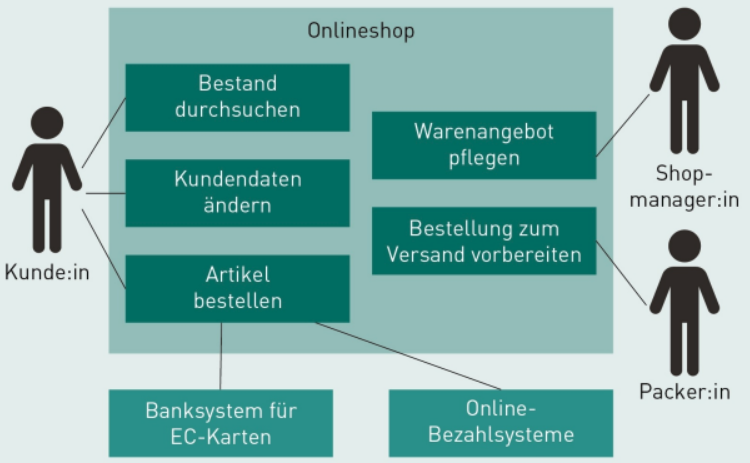

# IT-Projektmanagement

# L04 Stakeholder-, Kommunikations- und Risikomanagement

## Einleitung
*Mit der Stakeholder-Tabelle und der Stakeholder-Matrix konkrete Techniken zum Stakeholder Management vermittelt. Für das Kommunikationsmanagement werden verschiedene Arten von Veranstaltungen und Veranschaulichungen vorgestellt, mit denen die Projektleitung für eine strukturierte Kommunikation innerhalb des Projekts sorgen kann. Zur Unterstützung des Risikomanagements werden die Techniken Risikoliste und Risiko-Wert-Matrix erläutert.*

LERNZIELE

<ul>
    <li>Mit welchen Techniken das Stakeholder Management strukturiert werden kann.</li>
    <li>Mit welchen Veranstaltungen und welchen Veranschaulichungen die Kommunikation innerhalb des Projekts sichergestellt werden kann.</li>
    <li>Wie die Risikoliste und die Risiko-Wert-Matrix beim strukturierten Umgang mit Projektrisiken helfen.</li>
</ul>

ZUSAMMENFASSUNG

Aktives Stakeholder Management ist eine elementare Kernaktivität im Projektmanagement und eine der wichtigsten Aufgaben der Projektleitung. Jeder Stakeholder hat einen individuellen Hintergrund und Kenntnisstand sowie ein individuelles Problemverständnis. Daher sind die Ziele im Stakeholder Management neben der Erkennung aller relevanten Stakeholder auch die Herstellung und Aufrechterhaltung der Kooperationsbereitschaft.  

Je nach Art, Organisationsform und Komplexität des Projekts obliegt es der Projektleitung für ein geeignetes Kommunikationsmanagement zu sorgen. Dazu wurden in dieser Lektion die Kommunikationsformen Kickoff, Stand-up, Jour fixe, Workshop, Ergebnisvorstellung, Retrospektive und Postmortem vorgestellt. Darüber hinaus wurden die verschiedenen Arten von Veranschaulichungen Vision/Ziele, Meilensteinplan, Statusbericht (inkl. Projektampel), Burn Down Chart, Kanban Board, Gantt-Diagramm, Systemkontext und Earned-Value-Analyse vorgestellt, mit denen die Projektleitung für eine geeignete Kommunikationsunterstützung sorgen kann. Zur Unterstützung des Risikomanagements wurden die Techniken Risikoliste und Risiko-Wert-Matrix erläutert.

---
## 4.1 Stakeholder Management
### Was sind Stakeholder?
>Stakeholder (*dt. Anspruchsgruppen*) sind alle Personen, Gruppen oder Organisationen, die ein Projekt beeinflussen oder von ihm betroffen sind – oder sich betroffen fühlen (*Definition nach PMBOK 2017*).

- Jeder Stakeholder hat einen individuellen Hintergrund, Kenntnisstand und Problemverständnis -> eigene Sichtweisen und Prioritäten.

### Warum ist es so wichtig?
Aktives Stakeholder Management gilt als kritischer Erfolgsfaktor:  
Vergessene oder schlecht eingebundene Stakeholder können dazu führen, dass wichtige Anforderungen zu spät erkannt werden oder Entscheidungen gegen das Projektteam fallen.

### Ziele des Stakeholder Managements
- Alle relevanten Stakeholder identifizieren und analysieren (*Interessen, Macht, Einfluss auf Projekt*)
- Ihre Kooperationsbereitschaft herstellen und aufrechterhalten
- Ist ein kontinuierlicher Process (*wer dazu gehört als auch deren Beziehung zum Projekt kann sich ändern*)

### Die zwei zentralen Werkzeuge
1. **Stakeholder-Matrix** (*Macht–Interesse-Matrix*):  
Ordnet Stakeholder anhand von Einfluss und Interesse in vier Kategorien ein:

||Geringes Interesse |Hohes Interesse |
|---|---|---|
|**Geringe Macht** |Passiv involvieren |kontinuierlich Informiert halten |
|**Große Macht** |Zufrieden stellen   (*damit sie nicht gegen das Projekt handeln*) |**Key Stakeholder** – eng einbinden  (*größter Mehrwert*) |

2. **Stakeholder-Tabelle**:  
Um den Grad der Stakeholder-Involvierung im Detail zu planen werden alle relevanten Informationen zu jedem Stakeholder (*Rolle, benötigte Informationen, Erwartungen, Einfluss etc.*) dokumentiert.

|Name |Meier |Muller |
|---|---|---|
|**Kontaktdaten** |meier@company.com  Tel.: 0122–123556 |Muller@company.com  Tel.: 0332–22343323 |
|**Rolle** |Sachbearbeiter |Auftraggeber |
|**Macht** |gering |hoch |
|**Interesse** |hoch |hoch |
|**Unterstützung**  (*ggf. Projektrolle*) |Quelle für GUI-Anforderungen |Geld |
|**Benötigte Informationen** |Verbesserungsvorschläge |Freigabe der Anforderungen |

### Best Practices im Umgang mit Stakeholdern
- Regelmäßige **Statusbesprechungen** durchführen (*damit sie sich einbezogen fühlen*).
- Aus Projektbetroffenen durch **Motivation** Projektbeteiligte machen.
- **Aufmerksamkeit**: Anliegen von Stakeholdern ernst nehmen und wertschätzen.
- **Positive Stakeholder** halten (*einbeziehen, regelmäßig informieren*),  
**negative Stakeholder** überzeugen (*erläutern, motivieren*).
- **Verantwortungsbereiche** und **Weisungsbefugnisse** festlegen um Missverständnisse zu vermeiden und Kompetenzen festzulegen.

---
## 4.2 Kommunikationsmanagement
>Zur strukturierten Kommunikation innerhalb des Projekts (*Projektteam*) als auch extern (*Stakeholder*).

### Veranstaltungen (*Meetings*)
>Wird von der Projektleitung mit ausgewählten Stakeholdern initiiert.

|Name |Beschreibung |Ziele |
|---|---|---|
|**Kick-off**  (*meist als Workshop*)|erstes offizielles Meeting mit allen wichtigen Stakeholdern |- persönliches Kennenlernen  - Erwartungshaltung klären  - Art der Zusammenarbeit festlegen|
|**Daily**  (*auch  Daily Meeting, Stand-up*) |- feste Dauer (*5-15 min*)  - regelmäßig (*oft täglich*) zu festen Zeiten innerhalb des Projektteam  - nur berichten, keine fachliche Diskussion  - "Was habe ich gestern getan?"  - "Was tue ich heute?"  - "Welche Probleme habe ich gehabt?" |- kontinuierliche Kommunikation von Ergebnissen und Problemen im Projektteam |
|**Jour fixe**  (*dt. „fester Tag“*)|- Dauer 30-60 min.  - regelmäßiges, anlassunabhängiges Zusammentreffen bestimmter Stakeholder (*z.B. Portfoliomanager - Projektleitung, IT-Unternehmensarchitekt - Projektarchitekt*) zur detaillierten Besprechung oder dem Berichten von ausgewählten Aspekten des Projekts |- kontinuierliche Kommunikation von Berichten und Problemen ausgewählter Stakeholder zur Projektleitung bzw. zu anderen leitenden Funktionen |
|**Workshop** |- nach Bedarf  **1. Vorbereitung:**  *Ziel-Arbeitsergebnisse-Vorgehen-Organization  (Zeit, Dauer, Ort, Ressourcen, Einladungen)*  **2. Durchführung:**  *Erläuterung der Ziele-Arbeitsergebnisse-Vorgehen (Techniken)-Rollen-Regeln und Durchführung*  **3. Nachbereitung:**  *Aufarbeitung der Arbeitsergebnisse sowie ewt. Freigabe durch Stakeholder* |- gemeinsames Erarbeiten von Ergebnissen, Erkenntnissen und Entscheidungen  - Sicherstellung des Informationsflusses  - aktive Beteiligung relevanter Stakeholder ermöglichen |
|**Ergebnisvorstellung**  (*eng. Presentation*) |Zusammentreffen ausgewählter Projektmitglieder und Stakeholder, um erreichte Zwischen- oder Endergebnisse vorzustellen und zu diskutieren  (*Kritik-Verbesserungswünsche-Wertschätzung*)|- Transparenz zum aktuellen Fortschritt herstellen  - Rückmeldung seitens der Stakeholder zu Ergebnissen erhalten  - direkte Kommunikation von Entwicklungsteam und Stakeholder sicherstellen |
|**Retrospektive** |regelmäßiges Zusammentreffen der Teammitglieder zur gemeinsamen Reflexion der Art und Qualität der Zusammenarbeit  (*in Scrum am Sprintende*) |- Verbesserung der Zusammenarbeit im Projektteam |
|**Postmortem** |- in der Abschlussphase eines Projekts  - Zusammentreffen der Teammitglieder nach Abschluss des Projekts zur Reflexion und Bewertung der Projektprozesse und Rahmenbedingungen |- Feedback des Projektteams zu Projektmanagementprozessen und Rahmenbedingungen des Projekts  - Verbesserung der Qualität der Projektprozesse  -Bewertung der Ergebnisse aus Sicht des Projektteams und Stakeholdern  - Sammlung von „Lessons learned“ / „Best Practices“ um Fehler in Zukünftigen Projekten zu vermeiden |

Tipp: Timeboxing

All Veranstaltungen sollten streng als "timebox" durchgeführt werden.  
Das bedeutet, dass die ursprünglich veranschlagte Dauer unter keinen Umständen überschritten werden darf. Abgebrochene Diskussionen sollten gegebenenfalls in der nächsten Veranstaltung wieder aufgenommen werden. Das konsequente Durchsetzen (auch: Timeboxing) von Timeboxed-Veranstaltungen erfordert in der Anfangszeit hohe Disziplin und strenge Moderation. Nach einer gewissen Zeit stellt sich jedoch ein Gewöhnungseffekt ein, sodass sich die Teilnehmenden von Workshops oder Besprechungen von allein auf die wirklich wichtigen Dinge konzentrieren.

### Veranschaulichungen
>Zur unterstützung der Kommunikation innenhalb eines Projektteams als auch nach außen.

|Name |Beschreibung |Ziele |
|---|---|---|
|**Vision, Ziele** |kontinuierliches Kommunizieren und Darstellen der Projektziele bzw. Produktziele, insbesondere bei großen und längeren Vorhaben |- Fokussierung der Aktivitäten des Teams auf ein gemeinsames Ziel |
|**Meilensteinplan** |Darstellung von wichtigen Meilensteinen, entweder als Liste oder entlang einer Zeitachse ausgerichtet |- Darstellung des Überblicks des Projektplans  - Koordination von Teilprojekten  - Koordination mit anderen Projekten, zu denen es technische oder zeitliche Abhängigkeiten gibt |
|**Gantt-Diagramm** |Darstellung erforderlicher Teilaufgaben und Meilensteine inkl. deren Abhängigkeiten |- Darstellung aller erforderlichen Aktivitäten inkl. kritischer Pfad  - Kommunikation innerhalb eines Projekts  - Grundlage für Arbeits- und Ressourcenplanung  - Risikobewertung |
|**Statusbericht**  (*inkl. Projektampel*) |Kurzdarstellung der aktuellen Projektsituation bezüglich der Aspekte aktuelle Aktivitäten, Risikoveränderungen, Projektcontrolling |- Darstellung der wichtigsten Kennzahlen und Fakten zur aktuellen Projektsituation  - Befähigung des Portfolio-Managers zum Bericht an das Portfolio-Board |
|**Burn Down Chart** |einfache Darstellung des Verhältnisses von geplanten zu tatsächlich abgearbeiteten Aufgaben in einem relativ kurzen Projektzeitraum |- Transparenz des aktuellen Projektfortschritts gegenüber allen relevanten Stakeholdern |
|**Backlog** |priorisierte Liste aller bekannten Dinge, die im Rahmen eines Vorhabens zu tun sind oder benötigt werden, ggf. bezogen auf einen bestimmten Zeitraum |- Transparenz der Menge aller offenen Aufgaben bzw. der Menge aller offenen Aufgaben für einen bestimmten Zeitraum  - operative Arbeitsorganisation |
|**Board**  (*z. B. Kanban Board*) |Technik zur Darstellung und Organisation von offenen Aufgaben und deren Bearbeitungsstand in Projektteams |- Veranschaulichung des Bearbeitungszustands von Aufgaben und der Auslastung von Teammitgliedern  -  Unterstützung von selbstorganisierten Teams |
|**Earned-Value-Analyse** |Technik zur Ermittlung und Darstellung des aktuellen Projektfortschritts auf Basis der geleisteten Aufwände und geschätzten Restaufwände |- Ermittlung des Projektfortschritts und Kostenkontrolle  - Indikator für Kosten- und Zeitverhalten des Projekts bzw. von Arbeitspaketen |
|**Systemkontext** |Überblicksdarstellung der zu erstellenden und verändernden IT-Systeme inkl. deren Benutzendengruppen, Umsysteme und Hauptfunktionen |- Darstellung der Komplexität des ITProjekts  - Fokussierung in Workshops auf das aktuelle Ziel  - Identifikation relevanter Stakeholder  - Identifikation notwendiger Aktivitäten |

### Statusbericht
>Ist eine Zusammenfassung der aktuellen Projektsituation (*auch Teilaufgaben oder Teilprojekte*), welcher regelmäßig (*z.B. wöchentlich*) von der Projektleitung erstellt und z.B. in einem "Jour fixe" diskutiert wird.

#### Wozu dient er?
- Entscheidungsgrundlage für das PMO im Bezug auf die Projektunterstützung
- zum frühzeitigen erkennen von sich abzeichnenden Problemen (*sog. Projekthavarien*)

#### Enthält Aussagen zu folgenden Aspekten:
- aktuelle Situation des Projekts,
- Veränderungen des Projektrisikos,
- nächste geplante Maßnahmen,
- Ausblick (*z.B. anstehende Meilensteine*).

### Projektampel (*in Statusberichten*)
>Ist eine grafische Bewertung der aktuellen Projektsituation anhand der Aspekte **Kosten**, **Zeit**, **Qualität** und **Kundenerwartungen**. Konkreten Vorschriften zur Einfärbung bzw. Kennzahlen sind in der Regel organisations- und projektspezifisch. Sie sollten zu Beginn des Projekts zwischen der Projektleitung und dem PMO geklärt und festgelegt werden.

Mit den Ampelfarben werden folgende Aussagen veranschaulicht:
- **grün** = Projekt läuft ganz nach Plan
- **gelb** = kleinere, aber nicht kritische Probleme sowie
- **rot** = größere, kritische Probleme

Beispiel für Vorgaben zur Einfärbung der Projektampel

Mit der Auswertung der Projektampeln aller aktuellen Projekte eines Projektportfolios erhält das Projektportfolio-Board einen Überblick. Danach kann entschieden werden, ob es Risikoprojekte gibt, die genauer betrachtet werden müssen.

Beispiel für Ansicht aller Projektampeln eines Projektportfolios

### Systemkontext
>Ist eine Veranschaulichung der im Rahmen des Vorhabens zu erstellenden bzw. zu verändernden IT-Systeme. Zu jedem dieser Systeme werden jeweils die Benutzendengruppen, die benötigten Umsysteme und die Hauptfunktionen dargestellt. 

- zur Veranschaulichung von Komplexität (*diese darf nicht vereinfacht oder versteckt werden*)
- um Workshops und Diskussionen zu fokussieren
- zur Identifikation relevante Stakeholder (*jede Nutzergruppe ist ein S.*) und wichtigen Aktivitäten
- jedes Umsystem muss über technische Schnittstellen mit dem zu ändernden System kommunizieren können
- über der Laufzeit eines Projekts verändert sich der Systemkontext mit seinen Elementen
- die Verantwortung für die Erstellung und Pflege des Systemkontextes liegt beim Requirements Engineer

---
## 4.3 Risikomanagement
>Ein Risiko ist eine Gefahr für den Projekterfolg, die eine Verschlechterung des Projektstatus hinsichtlich der Aspekte **Kosten**, **Qualität**, **Zeit** und **Kundenerwartung** zur Konsequenz hat.

#### Risikokategorien:
- **Ressourcenrisiken**:  
z.B. der Ausfall von wichtigen Mitarbeitenden durch Krankheit oder von benötigter technischer Infrastruktur
- **Terminrisiken**:  
z.B. die Nichteinhaltung zugesagter Termine
- **Akzeptanzrisiken**:  
z.B. Unzufriedenheit oder Ablehnung des Projektergebnisses durch die Auftraggebenden
- **Kostenrisiken**:  
z.B. durch Zahlungsunfähigkeit der Kunden oder gestiegene Kosten von Lieferanten
- **technische Risiken**:  
z.B. beim Einsatz neuer Technologien oder Verfahren, die noch nicht ausgereift sind und zu denen es keine Erfahrungswerte gibt
- **Qualitätsrisiken**:  
z. B. eine lange Liste von bekannten Fehlern im aktuellen Projektergebnis oder erwartete, jedoch nicht umgesetzte Anforderungen an Softwaresysteme

#### Projektleitung ist Verantwortlich für Risikomanagement: 
- kontinuierliche Identifikation und Bewertung von Projektrisiken
- das Ergreifen geeigneter Gegenmaßnahmen, um die **Eintrittswahrscheinlichkeit** und die **Auswirkungen** von Risiken zu minimieren

### Risikoliste (*Identifikation & Bewertung*)
>Ist ein Managementartefakt (*Text oder Tabelle*) mir der die Menge der bekannten Risiken verwaltet wird. In der Regel können nicht alle Risiken eines Projekts vermieden oder abgeschwächt werden. Wichtig ist jedoch, dass alle relevanten Risiken erkannt worden sind und den Auftraggebenden bzw. dem PMO kommuniziert werden.

- Risikoliste wird zu beginn des Projekts erstellt und durch die Risikoanalyse im Projektverlauf kontinuierlich gepflegt
- Projektleitung kann in zusammenarbeit mit dem RE in regelmäßigen Jour fixen mit den relevanten Stakeholdern die Projektrisiken neubewerten und Gegenmaßnahmen diskutieren

#### Bestandteile einer Risikoliste:
- ID und Bezeichnung des Risikos,
- Auswirkungen bei Eintritt,
- Quelle (*wer das Risiko identifiziert hat*),
- Anmerkungen und Kommentare zu dem Risiko,
- Bewertung des Risikos hinsichtlich Auftrittswahrscheinlichkeit und Schadenshöhe,
- Gegenmaßnahmen zur Vermeidung oder Verminderung der Auftrittswahrscheinlichkeit und der Schadenshöhe,
- Zuständigkeiten (*Rollen und Namen*) die für die Gegenmaßnahmen zuständig sind.

#### Risikostrategien um Risikowahrscheinlichkeit bzw. Schadenshöhe zu begrenzen:
- **Vermeidung des Risikos**:  
z.B. durch Streichung bestimmter Anforderungen in Absprache mit den Auftraggebenden,
- **Verminderung des Risikos**:  
z B. durch Abschwächung bestimmter Projektziele,
- **Übertragung des Risikos**:  
z.B. durch entsprechende Vereinbarungen mit den Auftraggebenden,
- **Akzeptanz**:  
relativ unwahrscheinliche Risiken (*z.B. Meteoriteneinschlag*) oder Risiken mit geringer Schadenshöhe bewusst in Kauf nehmen.

#### Risiko-Wert-Matrix (*Planung & Priorisierung von AP*)
>Unterstützt die Projektleitung bei der Planung bzw. Priorisierung von Arbeitspaketen, um möglichst schnell potenzielle Risiken analysieren zu können. 

Arbeitspakete bzw. Anforderungen werden zum einen dahingehend bewertet, wie hoch der Wert bzw. der Nutzen ist, der durch die Umsetzung geschaffen wird. Zum anderen, wie hoch die Unsicherheit bzw. das Risiko des Arbeitspakets sind.  
Ziel ist das Projektrisiko durch das umsetzen der Aufgaben zu senken. Es ist wahrscheinlicher, Aufgaben mit hohem Risiko mit mehr Zeit zu lösen. Wenn sie jedoch nur einen geringen Wert bieten, dan senkt das Vermeiden ebenfalls das Projektrisiko.

*Risiko-Wert-Matrix*
||geringer Wert | hoher Wert |
|---|---|---|
|**hohes Risiko**|**Vermeiden:**  -> Nur auf ausdrücklichen Wunsch der Auftraggebenden umgesetzt!   *Nutzende der Rolle Shopmanager sollen die Farbe der Buttons in der GUI in den persönlichen Einstellungen anpassen können. Da das in der Architektur des Systems nicht vorgesehen ist, müssten grundlegende Funktionen des Shopsystems verändert werden.* |**Als Erstes umsetzen:** -> Mehr Zeit um Probleme zu lösen sowie Verringerung des Projektrisikos.  *Die Buchungsdaten des Onlineshops sollen automatisch in das CRM-System übernommen werden. Dazu muss eine technische Schnittstelle zwischen den Systemen neu erstellt werden. Das Entwicklungsteam hat noch keine Erfahrung mit den dazu benötigten Technologien und sieht daher ein gewisses Umsetzungsrisiko.* |
|**geringes Risiko**|**Zuletzt umsetzen:**   *Die Login-Seite soll schöner gestaltet werden, hier soll ein zufällig ausgewähltes Kunstwerk als Bild angezeigt werden. Das Entwicklungsteam sieht keinen großen Aufwand und kein Umsetzungsrisiko.*|**Als Zweites umsetzen:**   *Haben Nutzende eines Onlineshops noch nicht bestellte Waren im Warenkorb, soll nach sieben Tagen automatisch eine Mail mit einer Erinnerung versendet werden. Das Entwicklungsteam kennt sich mit dem Onlineshopsystem bestens aus und kann die Umsetzung optimal einschätzen.* |

**NOTE:** Im Module "Requirements Engineering" gibt es eine "Wert-Risiko-Matrix" in der zuerst "geringes_Risiko"-"hoher-Wert" umgestzt werden soll und als 2. "hohes_Risiko"-"hoher-Wert".