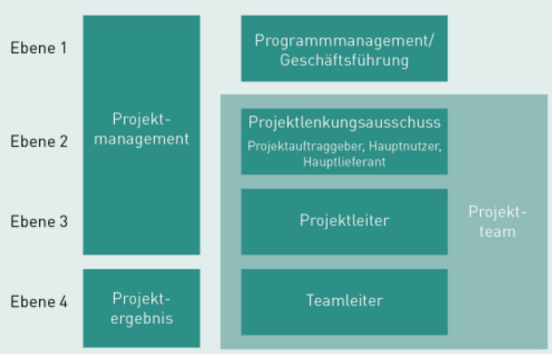
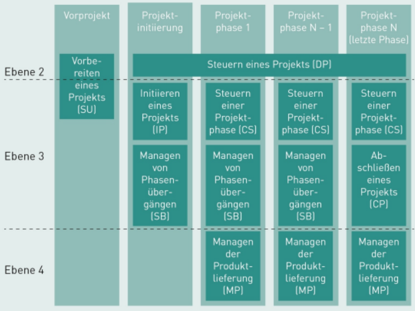

# IT-Projektmanagement

# L05 Organisation und Struktur von IT-Projekten

## Einleitung
In dieser Lektion werden die ausgewählten Managementmodelle Scrum, PITPM und PRINCE2 für die Organisation und Struktur von IT-Projekten gegenübergestellt.

LERNZIELE

<ul>
    <li>Welche Managementebenen in PRINCE2 unterschieden werden.</li>
    <li>Welche Managementprozesse es in PRINCE2 gibt und welche Ergebnisse in diesen Prozessen erzeugt werden.</li>
    <li>Welche Projektphasen es in PITPM gibt.</li>
    <li>Zu welchen Aspekten der Projektleitung entsprechende Managementpläne erstellt werden müssen.</li>
    <li>Mit welchen Aktivitäten die Projektleitung in PITPM ein IT-Projekt steuert.</li>
</ul>

ZUSAMMENFASSUNG

Scrum ist ein adaptives Managementmodell, das Vorhaben in kurzen Zyklen organisiert, in denen ein sich selbst organisierendes Scrum Team wirkt. Ein Scrum Team ist eine kleine Gruppe von interdisziplinären Fachleuten, die zusammen alle Kompetenzen haben, um das Produkt zu erstellen. In einem Scrum Team gibt es die drei Rollen: Product Owner, Scrum Master und Developer. Ein Zyklus in Scrum heißt Sprint, dauert höchstens einen Monat und ist strukturiert durch die Events Sprint Planning, Daily Scrum, Sprint Review sowie Sprint Retrospective. Die zentralen Elemente in Scrum sind Product Backlog, Sprint Backlog sowie das Increment.

PRINCE2 ist eine Methode für das IT-Projektmanagement für mittlere bis sehr große Projekte. Die Kernelemente von PRINCE2 sind die detaillierte Beschreibung von sieben Hauptmanagementprozessen, die daran beteiligten Rollen mit ihren Aufgaben und Zuständigkeiten sowie die im Rahmen der Aktivitäten zu erstellenden Managementartefakte. PRINCE2 unterscheidet im Rahmen eines Projekts vier verschiedene Managementebenen: Programmmanagement, Projektlenkungsausschuss, Projektleitung und Teamleitung. Jede dieser Ebenen ist dabei konkreten Managementprozessen zugeordnet.

---
## 5.1 Ausgewählte Managementmodelle für IT-Projekte: Scrum, PITPM und PRINCE2

||Scrum |PRINCE2 |PITPM |
|---|---|---|---|
|**Grundprinzip** |in kurzen Zyklen organisiertes, adaptives Managementmodell |Rahmenwerk mit Prozessen, Gremien und Rollen zum Projektmanagement |Pragmatischer Managementprozess für ITProjekte auf Basis von PMBOK |
|**Typisches Einsatzgebiet** |Entwicklung komplexer Produkte in Teams bis zu zehn Personen |Steuerung mittlerer bis sehr großer Projekte |Steuerung mittelgroßer IT-Projekte |
|**Kernelemente** |- selbstorganisiertes Scrum Team  - Scrum Sprint mit Scrum Events  - Product-Backlog |- sieben Prozesse zur Steuerung  - vier Managementebenen |- fünf Projektphasen mit Aktivitäten und Kontrollpunkten  - neun Wissensgebiete |
|**Spezifisch für IT-Vorhaben** |nein |nein |ja |

---
## 5.2 Überblick Scrum: Rollen, Events und Artefakte
>Ist ein iteratives[^1], inkrementelles[^2] und stark adaptives Managementmodell, es basiert auf kurzen Zyklen und einem sich selbst organisierenden Team.

[^1]: **iteratives**: in mehreren Zyklen (*Sprints*)
[^2]: **inkrementelles**: das "Produkt" wird stückweise weiter entwickelt, muss aber immer funktionsfähig bleiben

- Für die Erstellung eines komplexen "Produkts", auch außerhalb von IT-Projekten (*z.B. Marketing, Forschung, Bildung*).
- Es basiert auf den drei Säulen **Transparenz**, **Überprüfung** und **Anpassung**.

#### Das Scrum Team
Ist klein (*max. 10 Personen*), interdisziplinär und selbstorganisiert — ohne Teilteams oder Hierarchien.

|Rolle	            |Verantwortung |
|---|---|
|**Developer** *(im sinne von Produkt Entwickler & nicht nur Softwareentwickler)* |Konstruktive Arbeit am Produkt (*Konzeption, Entwicklung, Qualitätssicherung, Inbetriebnahme*) |
|**Product Owner**	|- Maximiert den Produktwert  - erstellt, pflegt und priorisiert die Backlock-Elementen im Product Backlog  - Entwicklung und Kommunikation des Produktziels  - Sicherstellung von Transparenz und Verständlichkeit des Backlogs|
|**Scrum Master**	|Setzt Scrum in Theorie & Praxis um; coacht das Team und beseitigt Hindernisse |

#### Events (*innerhalb eines Sprints*)
Ein Sprint (*Zyklus*) dauert maximal einen Monat und wird ohne Pause vom nächsten gefolgt.

|Event	            |Dauer (*bei 1-Monat-Sprint*)  |Zweck |
|---|---|---|
|**Sprint Planning**        |max. 8 Std.           |- **Sprint-Ziel** festlegen, *Product-Owner schlägt vor und Team formuliert es*  - **Backlog-Elemente** auswählen, *werden im Gespräch mit dem Product-Owner von den Developern ausgewählt*  - **Arbeit planen**, *Analyse der ausgewählten Backlog-Elemente durch die Developer* |
|**Daily Scrum**            |max. 15 Min. (*täglich*)    |- tägliche zur selben Zeit und Ort mit alle Developer  - Fortschritt prüfen und Hindernisse überwinden  - geplante Arbeit aufgrund der gewonnenen Erkenntnisse anpassen,  - umsetzbaren Plan für nächsten Tag erstellen |
|**Sprint Review**	        |max. 4 Std.	       |- Scrum Team stellt den relevanten Stakeholdern die **Ergebnisse** vor  - **Überprüfung** der Ergebnisse  - grobe **Planung** was als nächstes passiert und Backlog Anpassung |
|**Sprint Retrospective**	|max. 3 Std.	       |- Team **reflektiert** Sprint (*positive & negative Erlebnisse*) - Maßnahmen zur allgemeinen **Verbesserung** (*Zusammenarbeit & Produktqualität*) |

#### Scrum-Artefakte
|Artefakt               |Beschreibung |
|---|---|
|**Product Backlog**    |- geordnete, emergente[^3] Liste aller zu erledigenden Arbeit  - einzige quelle für alle Aufgaben   - **Product Backlog Refinement**: Product-Owner fügt nötige Informationen zur Umsetzung den Backlog-Elementen zu|
|**Sprint Backlog**	    |- Backlog-Elemente für Sprint + Sprint-Ziel + Arbeitsplan für den Sprint  - Developer passen kontinuierlich an |
|**Increment**          |- Sprint-Backlog-Element abgeschlossen + Definition of **Done** erfüllt → neues Increment  - am Ende des Sprints muss das Increment insgesamt verwendbar sein und wird im Sprint Review präsentiert  - Elemente, die die Definition of **Done** nicht erfüllen, dürfen im Review nicht präsentiert werden und wandern zurück ins Product Backlog |

[^3]: **emergente**: wird kontinuierlich angepasst (*niemals vollständig oder fertig*)

---
## 5.3 Überblick und Managementebenen von PRINCE2
>PRINCE2 steht für „**Pr**ojects **in** **C**ontrolled **E**nvironments" und wurde ursprünglich als britischer Regierungsstandard für IT-Projektmanagement entwickelt. Es eignet sich vor allem für mittlere bis sehr große Projekte und beschreibt detailliert:

- 7 Hauptmanagementprozesse
- 4 Managementebenen mit klaren Rollen und Zuständigkeiten
- Konkrete Managementartefakte, die zwischen Ebenen ausgetauscht werden

*Für kleine Projekte kann der administrative Aufwand aber unverhältnismäßig hoch sein.*

### Die 4 Managementebenen

<!-- |Ebene  |Bezeichnung        |Funktion |
|---|---|---|
|1	    |**Programm- management** /  **Geschäfts- führung** |- Externe Führungsebene (*nicht Teil des eigentlichen Projektteams*)  - löst das Projekt mit dem [Projektmandat](#projektmandat-project-mandate) aus |
|2	    |**Projekt- lenkungs- ausschuss** PLA  (*Project Board*)|- Oberstes Entscheidungsgremium  - verantwortlich für Projekterfolg (*Eingesetzte Mittel -> bestmögliche Ergebnis*) - nimmt Ergebnisse ab   **Projektauftraggeber** (*Executive*): - Hauptverantwortlich für das Projekt  - geben Rahmenbedingungen vor (*Kosten, Zeit, Qualität, Kundenerwartung*)  **Hauptnutzer** (*Senior User*):  - verantwortlich für Systemspezifikation, Qualität und Abnahmetest  - Priorisierung der Anforderungen & Informationsbeschaffung  **Hauptlieferant** (*Senior Supplier*):  - Erstellung des Systems nach Kundenanforderung  - überprüft Anforderungen der Hauptnutzer auf Umsetzbarkeit und Risiken|
|3	    |**Projektleitung** PL  (*Project Manager*)        |- Für Leitungsaufgaben des Tagesgeschäfts verantwortlich  - Umsetzung des Projekts innerhalb der vorgegebenen Rahmenbedingungen |
|4	    |**Teamleitung**  (*Team Manager*)              |- In kleinen Projekten optional (*wird dann von Projektleitung übernommen*) - Für Erstellung der Ergebnisse verantwortlich (*nur hier werden Ergebnisse erstellt*) | -->

<!-- *Ebene 1-3 Leiten das Projekt und erstellen Management-Artefakte. Ebene 4 erstellt die Ergebnisse (Wertschöpfung).* -->

#### 1. Ebene: Programmmanagement / Geschäftsführung
- Externe Führungsebene (*nicht Teil des eigentlichen Projektteams*)
- löst das Projekt mit dem [Projektmandat](#projektmandat-project-mandate) aus

#### 2. Ebene: Projektlenkungsausschuss PLA (*Project Board*)
- Oberstes Entscheidungsgremium (*kann das Projekt jederzeit beenden*)
- verantwortlich für Projekterfolg (*Eingesetzte Mittel -> bestmögliche Ergebnis*)
- nimmt Ergebnisse ab
- Rollen:
    ##### Projektauftraggeber (*Executive*):
    - Hauptverantwortlich für das Projekt
    - geben Rahmenbedingungen vor (*Kosten, Zeit, Qualität, Kundenerwartung*)
    ##### Hauptnutzer (*Senior User*):
    - verantwortlich für Systemspezifikation, Qualität und Abnahmetest
    - Priorisierung der Anforderungen & Informationsbeschaffung
    ##### Hauptlieferant (*Senior Supplier*):
    - Erstellung des Systems nach Kundenanforderung
    - überprüft Anforderungen der Hauptnutzer auf Umsetzbarkeit und Risiken

#### 3. Ebene: Projektleitung PL (*Project Manager*):
- Für Leitungsaufgaben des Tagesgeschäfts verantwortlich
- Umsetzung des Projekts innerhalb der vorgegebenen Rahmenbedingungen

#### 4. Ebene: Teamleitung TL (*Team Manager*):
- In kleinen Projekten optional (*wird dann von Projektleitung übernommen*)
- Für Erstellung der Ergebnisse verantwortlich (*nur hier werden Ergebnisse erstellt*)

### Die 7 Managementprozesse

#### Vorbereiten eines Projekts (SU *"Start up a Project" Ebene 2 & 3*)
###### Aktivitäten:
- Besetzten des Managementteams (*Ebene 2-4 [Projektlenkungsausschuss](#2-ebene-projektlenkungsausschuss-pla-project-board), [Projektleitung](#3-ebene-projektleitung-pl-project-manager), [Teamleitung](#4-ebene-teamleitung-tl-team-manager)*)
###### Dokumentation:
- Erfahrungen aus vorhergehenden Projekten
- [Projektsauftrag](M06_glossar.md#projektauftrag-project-brief), [Projektplan](M06_glossar.md#projektplan), Kurzversion des [Business Case](M06_glossar.md#business-case)
- [Plan-der-Phase-Projektinitiierung](M06_glossar.md#plan-der-phase-projektinitiierung) (*Plan für die erste Phase*)

#### Initiieren eines Projekts (IP *"Initiating a Project" Ebene 3*)
###### Aktivitäten:
- Strategien erstellen:
    - Risikomanagement (*wie auf Risiken reagieren*)
    - Steuerung, Erstellung und Änderung von Produkten und Artefakte
    - Qualitätsmanagement (*wie Ergebnisqualität sicherstellen*)
    - Kommunikationsmanagement (*wie & wann Stakeholder einbinden*)
    - Projektsteuerung (*wer Info Projektstand; welche Managementebene wie & wann Einfluss auf Fehlentwicklungen*)
- Auf basis des [Projektleitdokuments](M06_glossar.md#projektleitdokument-project-initiation-document-pid) entscheidet der [Projektlenkungsausschuss](#2-ebene-projektlenkungsausschuss-pla-project-board) ob das Projekt weitergeführt wird!
###### Dokumentation:
- [Projektplan](M06_glossar.md#projektplan), Ausarbeitung des [Business Case](M06_glossar.md#business-case)
- Zusammenstellung des [Projektleitdokuments](M06_glossar.md#projektleitdokument-project-initiation-document-pid)  

#### Managen von Projektphasenübergängen (SB *"Managing a Stage Boundary" Ebene 3*)
>Jedes mal nach Abschluss einer Phase und dem Beginn einer neuen Phase.
###### Aktivitäten:
- Aktualisieren:
    - [Projektplan](M06_glossar.md#projektplan) und [Business Case](M06_glossar.md#business-case)
- [Lenkungsausschuss](#2-ebene-projektlenkungsausschuss-pla-project-board) über den aktuellen Projektstatus informieren.
###### Dokumentation:
    - [Phasenabschlussreport](M06_glossar.md#phasenabschlussreport)
    - [Phasenplan](M06_glossar.md#phasenplan) für die nächste Phase
    - falls nötig [Ausnahmeplan](M06_glossar.md#ausnahmeplan-exception-plan)

#### Steuern eines Projektes (DP *"Directing a Project" Ebene 2*)
>Erstreckt sich über mehrere Phasen.
###### Hauptaktivitäten:
1. **"Genehmigen der  Phase 'Projektinitialisierung'"**:  
    - [Lenkungsausschuss](#2-ebene-projektlenkungsausschuss-pla-project-board) prüft [Projektauftrag](M06_glossar.md#projektauftrag-project-brief), [Plan-der-Phase-Projektinitiierung](M06_glossar.md#plan-der-phase-projektinitiierung) und [Business Case](M06_glossar.md#business-case).
    - Erst danach startet die Phase "Projektinitiierung".
2. **"Genehmigen des Projekts"** (*nach Phase "Projektinitiierung"*):
    -  [Lenkungsausschuss](#2-ebene-projektlenkungsausschuss-pla-project-board) bestätigen, dass die Projektziele und die angestrebten Ergebnisse ausreichend beschrieben und verstanden sind. 
    - erst danach darf die erste produktive Projektphase starten
    - [Projektleitdokument](M06_glossar.md#projektleitdokument-project-initiation-document-pid) wird frei gegeben und [Programmmanagement](#1-ebene-programmmanagement--geschäftsführung) über Projektstart informiert 
3. **"Genehmigen des Phasen-/ Ausnahmeplans"**:
    - von der [Projektleitung](#3-ebene-projektleitung-pl-project-manager) gelieferten Daten zum aktuellen Projektstatus werden geprüft und anschließend entschieden, ob das Projekt die nächste geplante Phase beginnen kann.  
        - Vergleich der erzielten mit geplanten Ergebnissen
        - Prüfung der Toleranzbereiche zu Kosten, Zeit und Qualität
        - Aktualisierung des [Business Case](M06_glossar.md#business-case) und der Projektrisikoliste
        - Begutachtung des [Phasenplans](M06_glossar.md#phasenplan) zur nächsten Phase
4. **"Bestätigen des Projektabschlusses"**
    - Projektreview = Vergleich ursprüngliche Pläne & Ziele mit Ergebnissen
    - Auswertung des [Business Case](M06_glossar.md#business-case) (*Nutzer, Kosten, Risiken, Return of Investment*) 
    - Erfahrungsbericht (*"Lessens learned"*)
    - Empfehlung für Folgeaktivitäten für die Betreuung des erstellten Systems

#### Steuern einer Projektphase (CS *"Controlling a Stage" Ebene 3*)
> Zu jeder Phase.
###### Arbeitspakete managen:
- Arbeitspakete beauftragen
- Statusberichte prüfen
- Arbeitspakete abnehmen
###### Monitoring und Reporting: (*um Probleme vorher zusehen*)
- Prüfen des Phasenstatus
- Regelmäßiger Bericht an [Lenkungsausschuss](#2-ebene-projektlenkungsausschuss-pla-project-board)
###### Problemlösung:
- Probleme und Risiken aufnahmen und untersuchen
- Gegenmaßnahmen
- Eskalation an [Lenkungsausschuss](#2-ebene-projektlenkungsausschuss-pla-project-board)

#### Managen der Produktlieferung (MP *"Managing Product Delivery" Ebene 4*)
###### Teamplan erstellen:
- Anforderungen/Ziele mit Projektleiter verhandeln
- Teamplan zur Bearbeitung des Arbeitspakets erstellen
###### Regelmäßige Prüfung:
- Reporting an übergeordnete Ebene mit Standardbericht
###### Qualitätsgesicherte Ergebnisse erstellen:
- Vermerken der erstellten/geprüften Ergebnisse in [Qualitätsbericht](M06_glossar.md#qualitätsbericht-quality-register) (*"Quality Register"*)
###### Ergebnisse übergeben:
- Projektleitung nimmt Ergebnisse ab und beendet Arbeitspakete

#### Abschließen eines Projekts (CP *"Closing a Project" Ebene 3*)
###### Dokumente für Lenkungsausschuss:
- Projektabschlussbericht
- Erfahrungsbericht
- Entwurf für die Benachrichtigung an alle relevanten Stakeholder
###### Informationen für Betrieb:
- Empfehlungen für Folgeaktivitäten
- Produktinformation

Footnote

[^4]: PLA: Projektlenkungsausschuss
[^5]: PL: Projektleitung

---