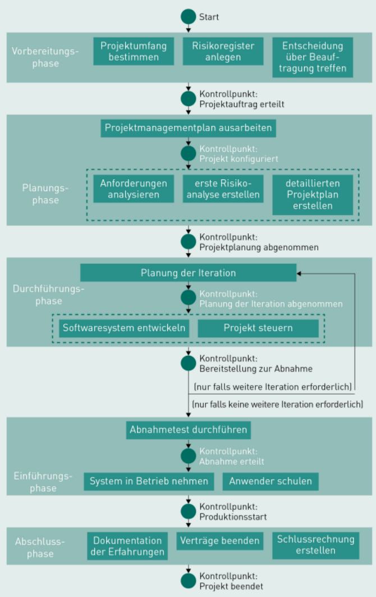

# IT-Projektmanagement

# L06 Pragmatisches IT-Projektmanagement (PITPM)

## Einleitung

LERNZIELE

<ul>
    <li>Welche Phasen und Kontrollpunkte PITPM umfasst.</li>
    <li>Welche Aktivitäten zur Konfiguration eines IT-Projekts durchgeführt werden.</li>
    <li>Welche Aktivitäten zur Steuerung eines IT-Projekts durchgeführt werden.</li>
</ul>

ZUSAMMENFASSUNG

Das Managementmodell Pragmatisches IT-Projektmanagement (PITPM) ist eine Erweiterung und Anpassung des PMBOK und richtet sich gezielt an kleine und mittlere Softwareprojekte. Ein IT-Projekt wird in PITPM in die Phasen Vorbereitungsphase, Planungsphase, Durchführungsphase, Einführungsphase und Abschlussphase aufgeteilt. In der Planungsphase legt das Projektmanagement fest, wie das Projekt die von ihm erwarteten Ergebnisse erstellt. Hierzu werden eine Reihe von Aspekten und Vorgaben festgelegt, innerhalb derer das Projektteam die von ihm erwarteten Ergebnisse erbringt.

In der Durchführungsphase steuert das Projektmanagement die tagtägliche Arbeit im Rahmen der getroffenen Festlegungen. Dabei wird der PMPlan angewendet und bei Bedarf ergänzt und angepasst. Hierzu zählen neben der Teamentwicklung auch das Controlling von Umfang und Budget, die Überwachung der Kommunikation, Risiken und Zulieferungen sowie der Planungs-, Entwicklungs- und Testaktivitäten.

---
## 6.1 Struktur und Phasen in PITPM
- Erweiterung und Anpassung des [PMBOK](M06_glossar.md#pmbok)-Guides.
- Für kleine und mittlere Softwareprojekte geeignet (*4-12 Personenmonate, 3-12 Kalendermonate, Budget von 75-500 TEUR*)
- Kontrollpunkt: Entscheidung über den Übergang in folgende Phasen und Kontrolle von wichtigen Ergebnissen.  

*Phasen, Aktivitäten und Kontrollpunkte im PITPM*

**1. Phase:** *Vorbereitung*:

- Ausarbeitung des [Projektauftrags](M06_glossar.md#projektauftrag-project-brief)
- Abstecken des Projektumfangs
- Erste Risikoabschätzung und Anlage eines Risikoregisters
- Entscheidung, ob Projekt beauftragt werden soll

##### Kontrollpunkt: "**Projektauftrag erteilen**"

**2. Phase:** *Planung*:

- Entscheidungen um das Projektmanagement
- Ausarbeitung der Projekt-Konfigurationen und Erstellung des Projektmanagementplans (PM-Plan), Festlegen von Personen, Aktionen, Plänen, Maßnahmen je Wissensgebiet

##### Kontrollpunkt: "**Projektkonfiguration akzeptiert**"

- Anforderungsanalyse, Risikoanalyse, Risikobewertung
- Detaillierter Projektplan

##### Kontrollpunkt: "**Projektplan abgenommen**"

**3. Phase:** *Durchführung*:

- diese Phase erfolgt in mehreren Iterationen
- Planung der Iteration
- **Kontrollpunkt: "Planung der Iteration"**
- Softwaresystem wird entwickelt & Projekt gesteuert

##### Kontrollpunkt: "**Bereitstellung zur Abnahme**" (*nach jeder Iteration*)

**4. Phase:** *Einführung*:

- Planung der Einführung und Durchführung des Abnahmetests
- **Kontrollpunkt: "Abnahme erteilt**" -> Überführung Systems in Betrieb
- Anwender müssen ewt. qualifiziert werden

##### Kontrollpunkt: "**Produktionsstart**"

**5. Phase:** *Abschlussphase*:

- Dokumentation von Erfahrungen
- beenden von Verträgen
- Schlussrechnung für Projekt

##### Kontrollpunkt: "**Projekt beendet**"

---
## 6.2 IT-Projekt "konfigurieren"
- In der "Planungsphase" konfiguriert das Projektmanagement das Projektmanagement.
- Die Projektmanagement-Pläne & Aktivitäten leiten sich aus den 9 Wissensgebieten des PITPM ab.

**1.:** *Projektteam aufstellen*:

- Auf Basis des Projektauftrags und der Vorbereitungsphase.
- Abdeckung aller erforderlicher Kompetenten und Fähigkeiten.
- Zu beachtende Kriterien der Zusammenstellung:
    - Verfügbarkeit
    - Kosten
    - Erfahrung
    - Kompetenzen
    - Kunden- und Branchenwissen
    - Toolkenntnisse
    - Verhalten im Team
    - Kommunikationsmöglichkeit, bzgl. Zeitzonen, räumliche Nähe und Sprachen

**2.:** *Kick-off-Workshop durchführen*:

- Organisation: Projektmanagement
- Teilnehmer: alle aktuell bekannten Projektbeteiligten
- Vorstellung von: allen Beteiligten, Ziel, Zeitraum und Meilensteine
- Äußerung der Erwartungen an Projekt und dessen Management
- Ziel: Entwicklung eines gemeinsamen Verständnisses über das Projektziel und das gegenseitige Kennenlernen
- Evtl. teambildende Aktivitäten

**3.:** *Projektmanagementplan entwickeln*:

- Wie läuft das Projekt ab?
- Anpassung des PITPM-Prozessmodelles auf spezifische Besonderheiten
- Ziel: Initiales Durchdenken der Projektaufgaben durch den Projekteiter
- Der PM-Plan dokumentiert ...
    - Werkzeuge und Techniken
    - Verfahren mit Änderungen
    - Messung der Geschwindigkeit
    - Vorgaben zum Review und zur Freigabe
    - Kommunikation untereinander / mit Management
    - Prozesse und Systeme zur Unterstützung für Projektleiter

**4.:** *Risikoplanung konfigurieren*:

- Ziel: nicht die einzelnen Risiken identifizieren, sondern zu definieren, wie das Risikomanagement allgemein im Projekt durchgeführt werden soll
- Vorgaben über Vorgehensweisen, Regeln und Eskalationspfade
- Allgemeine Beschreibung, wie mit Risiken umzugehen ist und welche Konsequenzen möglich sind

**5.:** *Beschaffung/Zulieferungen planen*:

- Vorgaben und Rahmenbedingungen für Beschaffungen im Projekt (*Freigabeprozesse, Kostengrenzen, Standards und zu berücksichtigende DIN-Normen*)
- Beispiele: Lieferanten mit Zertifikaten, bestimmte Hardware, zentrales Lizenzmanagement
- Vertragsarten:
    - Time and Material (T&M)
    - Fixed Price Contract (FFP)
    - Fixed Price Incentive Fee Contract (FPIF)
    - Fixed Price with Economic Price Adjustment (FP-EPA)

**6.:** *Projekt-Controlling aufsetzen*:

- Aufwandsschätzung überprüfen bzw. Ersteinschätzung vornehmen
- Kostenplangenehmigung bei überschrittenen Toleranzgrenzen
- Erstellung Kostenkurve für jedes Arbeitspaket
- Festlegen der Aufwands- und Kostenkontrolle im Projekt

**7.:** *Softwareentwicklung konfigurieren*:

- Auswahl eines Softwareprozessmodelles
- Bereitstellung der Werkzeuge zur Entwicklung und Betrieb der Software

**8.:** *Projektkommunikation planen*:

- Analyse der Stakeholder auf deren Bedürfnisse und Interessen
- Auf Basis der Analyse: Wie stark werden einzelne Stakeholder eingebunden?
- Typische Elemente: regelmäßige Meetings innerhalb des Teams, mit dem Auftraggeber oder dem Lenkungsausschuss
- Festlegung des Berichtwesens: Welche Berichte müssen wann an wen übergeben werden?

**9.:** *Anforderungsmanagement konfigurieren*:

- Festlegen der Organisation des fachlichen Requirements Engineering
- Wie wird mit Änderungsanfragen (Change Requests) verfahren?
- Erfolgt in Abstimmung mit verantwortlichem Requirements Engineer
- Festlegen über die Erhebung, Dokumentation, Qualitätssicherung, Änderung und Freigabe von Anforderungen
- Change Request Management: Wie wird mit späteren Änderungsanforderungen verfahren?

**10.:** *Change-Request-Prozess planen*:

- Behandlung von Änderungen und Anpassungswünschen seitens des Kunden im PM-Plan festgelegt
- Berücksichtigung des Kostenrahmens, da zusätzliche Umsetzungsaufwände
- Change-Request-Prozess: Definition von Entscheidungswege für späte Anforderungen

**11.:** *Qualitätsplanung erstellen*:

##### Konstruktives Qualitätsmanagement:
- Definition von Qualitätseigenschaften **a priori** (*vor der Erstellung*)
- Zur Vermeidung von Fehlern
- Maßnahmen: technisch, organisatorisch und zwischenmenschlich

##### Analytisches Qualitätsmanagement:
- Maßnahmen zur Prüfung und Bewertung des aktuellen Qualitätsniveaus **ex post** (*nach Erstellung*)
- Statisch (*Reviews, Audits*) oder Dynamisch (*Prüfung mit konkreten Eingabedaten*)

---
## 6.3 IT-Projekt steuern
- Die bei der Konfiguration des Projekts erstellte PM-Plan wird angewendet und bei Bedarf ergänzt und angepasst.

**Aktivität:** *Teams bilden und Aufgaben zuweisen*:

- Entwicklung einer Gruppe zu einem Team
- Klare Erwartungen an das Team innerhalb des Projekts
- Ergebnisse, Schlüsselaufgaben und Entscheidungsbefugnisse
- Regelmäßiges und anonymes Teambarometer: Befragung der Teammitglieder bezüglich Qualität der Ergebnisse, Entsprechung der Kundenerwartung, Güte der Kommunikation im Team, etc. 

**Aktivität:** *Projektteam steuern*:

- neue zusammengestellte teams durchlaufen eventuell folgende Phase (*Teamuhr = iealtypisches Modell*):
    |Phase |Eigenschaften |Maßnahmen |
    |---|---|---|
    |Orientierung |vorsichtig, höflich, gespannt, unpersönlich |frühe Einbeziehung, Raum zum Kennenlernen bieten, Hilfestellung geben; Kick-off-Workshop |
    |Machtkampf |unterschwellige Konflikte, Cliquenbildung, mühsames Vorankommen |Klärungsworkshops |
    |Organisation |Entwicklung neuer Umgangsformen, Feedback |Freiraum geben, Regeln einhalten |
    |**Leistung** (*angestrebte Phase*) |hilfsbereit, offen, solidarisch |Führung abgeben, Gruppendynamik beobachten |
    |Auflösung | |Go-live-Party, geleistete Arbeit hervorheben |
- Veränderungen im Team können zum erneuten durchlaufen einer Phase führen => beobachten, Teambarometer
- Ziel: Team zu entwickeln das unter hohem Leistungsdruck, eigenverantwortlich und kreativ arbeitet.
- Grundpfeiler für ein motiviertes Team:
    - Vertrauen
    - Transparenz
    - offene Feedbackkultur
    - Fehlertoleranz

**Aktivität:** *Projektumfang kontrollieren/anpassen*:

- Nicht alle Anforderungen können zu Beginn geklärt werden
- Deshalb: Kontinuierliche Prüfung, wie geänderte Anforderungen Auswirkungen auf die ursprüngliche Planung haben 
- Bei Bedarf: Change Request verfassen und auslösen (*um z.B. zusätzliche Ressourcen zu erhalten*)

**Aktivität:** *Projektkosten kontrollieren*:

- Kontinuierliche Kostenkontrolle
- Auskunftsfähigkeit sicherstellen
- Angefallene Kosten erfassen und offene restaufwände schätzen
- Bestimmung und Bewertung der Kostensituation mithilfe von Earned Value Analyse (Vorschlag von PITPM)

**Aktivität:** *Feinspezifikation für Iteration erstellen*:

- Auswahl der wichtigsten und zusammenhängenden Anforderungen, die innerhalb eines Zyklus entwickelt werden sollen
- Spezifizierung der Anwendungen mit dazu gehörigen Testfällen
- Berücksichtigung aller bisher gewonnenen Kenntnisse

**Aktivität:** *Feinspezifikation technisch abnehmen*:

- Bestätigung der Umsetzbarkeit der Feinspezifikation durch eine Rolle der Umsetzung (z.B. ein Softwarearchitekt)
- Ziel: Sicherstellung, dass das Entwicklungsteam in der Lage ist, die Anforderungen zu verstehen und wie gewünscht umzusetzen

**Aktivität:** *Projektkommunikation steuern*:

- Sicherstellen, dass definierte Kommunikationssteuerung wirklich durchgeführt wird
- Einhaltung regelmäßiger Statusberichte
- Einbeziehung relevanter Stakeholder

**Aktivität:** *Risiken überwachen*:

- Begleitendes Risikomanagement
- Weiterempfehlung des Risikoregisters
- Identifikation und Bewertung von Risiken
- Entscheidung über Bewältigungsstrategie bei Risiken

**Aktivität:** *Zulieferungen steuern*:

- Kontrolle der zugelieferten Leistungen (z.B. Beratung, komplette Teilsysteme)
⁻ Abrechnung der Leistungen
⁻ Kündigung von Verträgen
⁻ Bewertung der Zusammenarbeit

**Aktivität:** *Software entwickeln*:

- Durchführung der Software Engineering-Kernaktivitäten
- Entwurf, Implementierung und Test der Software
- Nach Abschluss: Abnahmetest und Übergabe in Entwicklungsphase

**Aktivität:** *Software testen*:

- Am Ende jedes Zyklus liegt ein potenziell benutzbares Ergebnis
- Das veränderte System muss so getestet werden, dass es grundsätzlich bereit zur Abnahme ist
- Durchführung von Integrations- und Systemtests
- Dokumentation und Bewertung des Testergebnisses

**Aktivität:** *Iteration abschließen und bereitstellen*:

- Ende der operativen Durchführung eines Zyklus
- Abgleich erzielter Ergebnisse mit dem Zyklusplan
- Bewertung der Qualität des erzielten Ergebnisses und der Zusammenarbeit, Vereinbarungen zur Qualitätsverbesserung
- Dokumentation der abgearbeiteten Anforderungen
- Weitere Zyklen werden grob vorgeplant
- Letzter geplanter Zyklus: Ergebnis dem Auftraggeber bereitstellen
- Übergang in Einführungsphase

